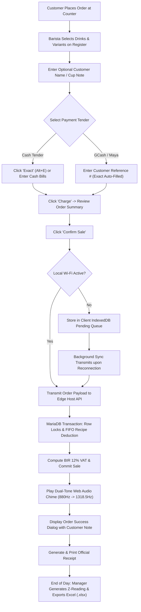
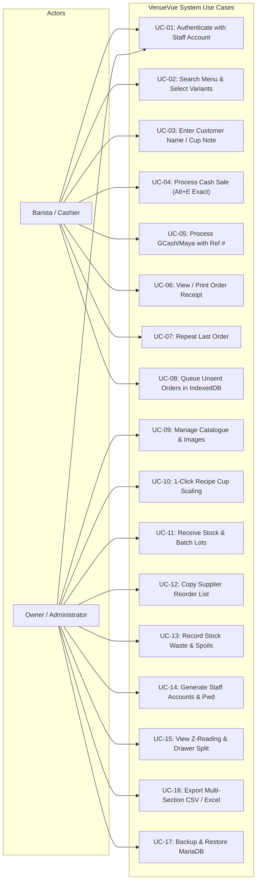
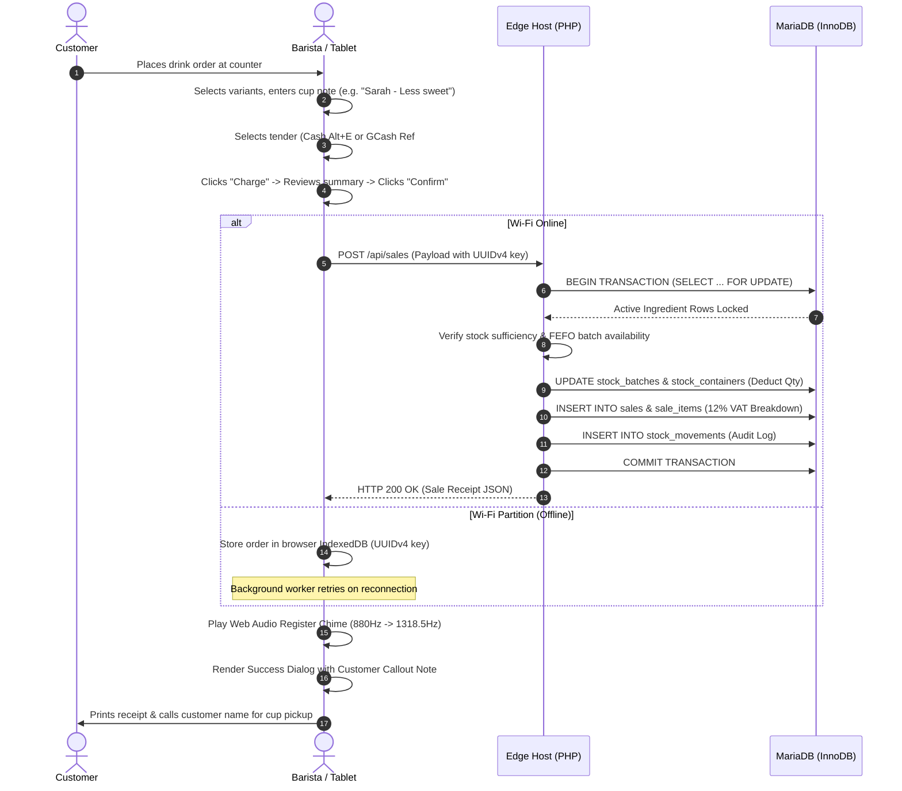
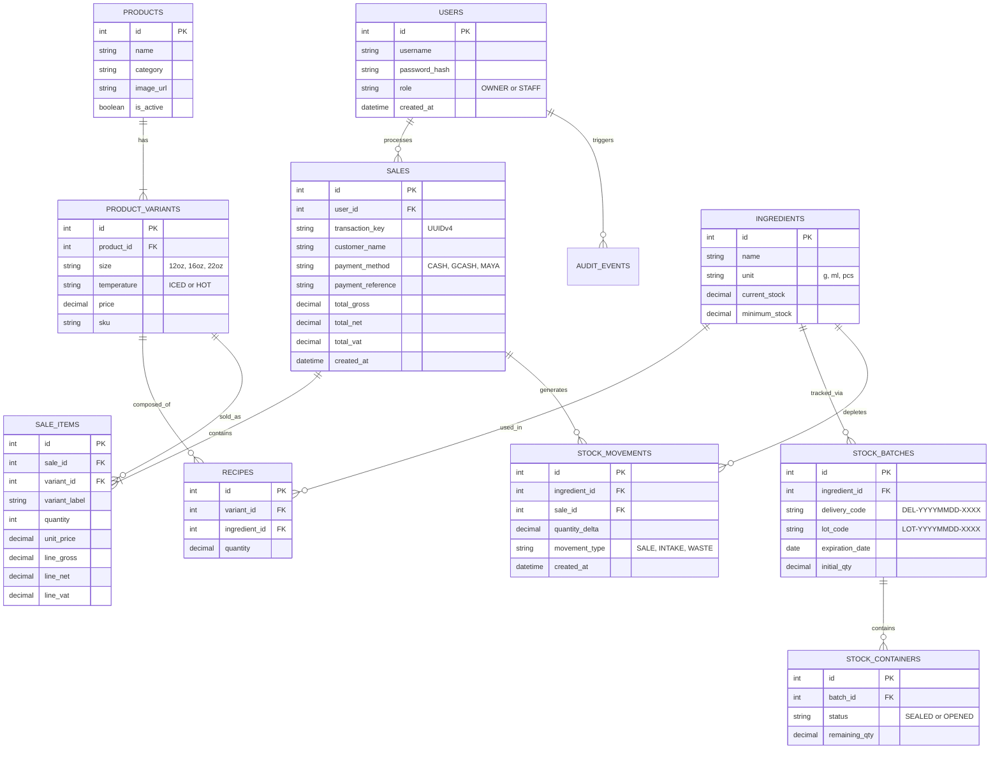

# VenueVue: Software Requirements Specification (SRS)
## An Internet-Independent, Locally Networked, Offline-First Point-of-Sale and Recipe-Driven Inventory System for Nearby Café

**Academic Course:** COSC 70: Software Engineering II  
**Academic Institution:** Cavite State University (CvSU) – College of Engineering and Information Technology (CEIT)  
**Client / Domain Partner:** Nearby Café – Legaspi St., Intramuros, Manila (near Lyceum of the Philippines University - LPU)  
**Engineering Team:** CTRL + STAY  
**Group Members / Authors:**  
- **Zapico, Zaki** (Project Manager / Lead Architect)  
- **Roquid, Jenny Lyn** (Systems Analyst / Technical Writer)  
- **Gregorio, Rhea Mae** (QA Engineer / Data Specialist)  
**Document Revision:** 1.0 (Production-Aligned Baseline)  
**Date of Issue:** November 4, 2026  

---

## Table of Contents
1. [Introduction](#1-introduction)
   - 1.1 [Purpose and Scope](#11-purpose-and-scope)
   - 1.2 [Overall System Description](#12-overall-system-description)
2. [System Requirements](#2-system-requirements)
   - 2.1 [User Characteristics and Roles](#21-user-characteristics-and-roles)
   - 2.2 [Functional Requirements](#22-functional-requirements)
     - 2.2.1 [System Features](#221-system-features)
     - 2.2.2 [Business Rules](#222-business-rules)
   - 2.3 [System Modules and Functions](#23-system-modules-and-functions)
   - 2.4 [Non-Functional Requirements](#24-non-functional-requirements)
     - 2.4.1 [Performance and Usability](#241-performance-and-usability)
     - 2.4.2 [Security and Reliability/Availability](#242-security-and-reliabilityavailability)
     - 2.4.3 [Maintainability and Scalability](#243-maintainability-and-scalability)
3. [System Models and Diagrams](#3-system-models-and-diagrams)
   - 3.1 [System Workflow](#31-system-workflow)
   - 3.2 [Use Case Diagram](#32-use-case-diagram)
   - 3.3 [Use Case Descriptions](#33-use-case-descriptions)
   - 3.4 [Activity Diagram](#34-activity-diagram)
   - 3.5 [Data Flow Diagram (DFD)](#35-data-flow-diagram-dfd)
   - 3.6 [Entity-Relationship Diagram (ERD)](#36-entity-relationship-diagram-erd)
4. [Data Requirements](#4-data-requirements)
   - 4.1 [Data Validation Rules](#41-data-validation-rules)
   - 4.2 [Data Security and Privacy Requirements](#42-data-security-and-privacy-requirements)
   - 4.3 [Data Retention and Backup Requirements](#43-data-retention-and-backup-requirements)
5. [Definition of Terms](#5-definition-of-terms)
6. [References](#6-references)

---

## Document Revision History

| Version | Date | Author(s) | Reason for Changes |
| :--- | :--- | :--- | :--- |
| **0.1** | Sep 21, 2026 | Roquid, J. L. | Initial Software Requirements Specification draft. |
| **0.9** | Oct 27, 2026 | Zapico, Z., Gregorio, R. | Architectural alignment and edge server model integration. |
| **1.0** | Nov 04, 2026 | Zapico, Z., Roquid, J., Gregorio, R. | **Approved Baseline:** Aligned with Nearby Café's physical shop setup on Legaspi St., Intramuros near LPU, dual cash/e-wallet checkout, BIR 12% VAT calculations, End-of-Day Z-Reading isolating Physical Cash from E-Wallets, multi-section CSV/Excel exports, FIFO batch lots, 1-click cup scaling, and Web Audio register chime. |

---

# 1. Introduction

### 1.1 Purpose and Scope
The purpose of this Software Requirements Specification (SRS) document is to establish a rigorous, verifiable, and complete specification of the functional, non-functional, interface, and data requirements for **VenueVue: An Internet-Independent, Locally Networked, Offline-First Point-of-Sale (POS) and Recipe-Driven Inventory System**. This specification serves as the formal baseline between the software development team **CTRL + STAY**, the client **Nearby Café**, and academic evaluators at **Cavite State University**.

**Nearby Café** is an active, physical specialty coffee shop situated on Legaspi St., Intramuros, Manila, operating in the immediate vicinity of Lyceum of the Philippines University (LPU Manila). Serving university students, faculty, administrative staff, and tourists visiting the historic walled city, the café experiences intense transaction peaks during class transition intervals and dismissal periods. 

> [!IMPORTANT]
> **Operational Scope Boundaries:**
> 1. **High-Speed Counter Register:** Cash tendering with keyboard shortcuts (Alt+E for exact cash), preset denominations (₱100, ₱500, ₱1,000), Philippine cashless e-wallets (GCash, Maya, QR Ph / Card) with customer reference recording, customer cup note callouts (e.g., *"Sarah - Less sweet"*), repeat order capability, and synthesized Web Audio chime feedback.
> 2. **Atomic Recipe Deduction Engine:** Server-authoritative bill of materials (BOM) deduction executing under database row-level locking (`SELECT ... FOR UPDATE`), converting beverage variant sales into exact component deductions (espresso beans in grams, dairy and syrups in millilitres, and cups/lids in units).
> 3. **1-Click Recipe Cup Scaling:** Proportional automated scaling of recipe ingredient quantities across standard 12oz, 16oz, and 22oz beverage sizes based on fluid volume ratios.
> 4. **FIFO Batch Lot Management:** Stock intake tracking utilizing auto-generated delivery and lot codes (`DEL-YYYYMMDD-XXXX`, `LOT-YYYYMMDD-XXXX`), expiration date monitoring, opened-container tracking, waste recording, and a 1-click supplier reorder list clipboard export formatted for Viber and Messenger.
> 5. **Financial Reporting & Compliance:** Automated BIR-compliant 12% Value Added Tax (VAT) computations, End-of-Day Z-Readings strictly isolating Physical Cash in Drawer from Digital E-Wallets, multi-section structured CSV reports, and native styled Microsoft Excel (`.xlsx`) workbooks.
> 6. **Local Edge Network Independence:** 100% operational availability on an isolated Wi-Fi Local Area Network (LAN) without external WAN/Internet dependency, supported by client-side IndexedDB persistence, UUIDv4 transaction keys, and SHA-256 idempotency enforcement.

### 1.2 Overall System Description
VenueVue is engineered around a local edge client-server architecture designed specifically to overcome Intramuros' infrastructure vulnerabilities, where historic thick volcanic stone masonry walls and telecommunication congestion frequently degrade cellular reception and cause broadband dropouts. 

A designated shop computer functions as the authoritative edge host, running an offline Apache 2.4, PHP 8.2, and MariaDB 10.4+ (InnoDB) stack. Front-of-house counter tablets and barista devices connect to this host over a local Wi-Fi hotspot broadcasting on the local subnet (`192.168.137.x`).

Client devices execute a touch-optimized React 18 Single Page Application (SPA) served directly from the host. When orders are rung up, the client creates an order record in local browser IndexedDB storage and transmits it to the PHP REST API. The MariaDB database acquires exclusive row locks (`SELECT ... FOR UPDATE`) on affected ingredient rows, verifies stock availability, commits the sale, records line items, and logs stock movements within a single ACID transaction. If the local Wi-Fi network experiences a temporary disruption, orders remain durable in client IndexedDB and automatically synchronize upon reconnection without duplicate recording.

---

# 2. System Requirements

### 2.1 User Characteristics and Roles

| User Role | Interface Scope | Primary Capabilities & Responsibilities |
| :--- | :--- | :--- |
| **Barista** *(Counter / Cashier)* | Register Interface (`/`) | Restricted exclusively to high-speed order processing. Searches drinks (`/`), selects size/temperature variants, inputs customer cup notes (e.g., *"Sarah - Table 4 - Less sweet"*), applies exact cash (Alt+E) or captures GCash/Maya reference numbers, confirms sales, triggers Web Audio chimes, views/prints receipts, repeats last orders, and monitors offline pending queue. **Strictly blocked from management endpoints, cost structures, and sales reports.** |
| **Owner / Administrator** | Management Interface (`/management`) | Holds full supervisory authority. Manages Catalogue & Recipes (1-click cup scaling across 12oz, 16oz, 22oz, image uploads, price adjustments), Inventory & Batch Lots (intake batches, expiration monitoring, waste logs, 1-click supplier reorder clipboard export), Staff Administration (generating usernames and strong temporary passwords), Audit History (stock movements, void logs), and Financial Reporting (Z-Readings, 12% VAT calculations, cash drawer isolation, multi-section CSV/Excel exports). |

---

### 2.2 Functional Requirements

#### 2.2.1 System Features

| Feature ID | Feature Name | Detailed Description |
| :--- | :--- | :--- |
| **SF-01** | Multi-Tender Register | Enables baristas to rapidly ring up drinks, filter by category, enter cup notes, apply exact cash (Alt+E), or capture GCash/Maya reference numbers with instant dual-tone Web Audio chime feedback upon confirmation. |
| **SF-02** | Atomic Recipe Deduction | Server atomically verifies and deducts raw ingredient quantities (grams, ml, pieces) from active stock under row-level database locks upon host sale confirmation. |
| **SF-03** | 1-Click Cup-Size Scaling | Enables managers to duplicate an existing beverage recipe and automatically scale ingredient quantities proportionally based on fluid ounce volume ratios (12oz, 16oz, 22oz). |
| **SF-04** | FIFO Batch Lot Tracking | Tracks stock intake via unique delivery/lot codes (`DEL-...`, `LOT-...`), monitors expiration dates, enforces First-In, First-Out depletion, and records spoiled/expired waste. |
| **SF-05** | Supplier Reorder Tool | Identifies ingredients at or below minimum threshold levels and provides a 1-click button copying a cleanly formatted procurement list directly to the clipboard for Viber/Messenger. |
| **SF-06** | Offline IndexedDB Queue | Preserves unsent orders in browser IndexedDB during Wi-Fi dropouts; background sync transmits records upon reconnection using UUIDv4 idempotency to prevent duplicate charges. |
| **SF-07** | Financial Z-Reading & VAT | Automatically extracts 12% VAT (Gross, Net, VAT), computes daily totals, and produces an End-of-Day Z-Reading isolating Physical Cash in Drawer from Digital E-Wallets. |
| **SF-08** | Multi-Section Excel / CSV | Generates professional multi-section CSV reports and native styled OpenXML Microsoft Excel (`.xlsx`) workbooks containing executive summaries, SKU performance, and cashier audits. |
| **SF-09** | RBAC & Staff Generator | Enforces server-side role segregation; provides auto-suggested usernames and 1-click cryptographically strong temporary password generation for baristas. |
| **SF-10** | Cryptographic Backup & Restore | Provides owner-triggered database snapshot exports with an automated preflight integrity verification and safe restore routine. |

#### 2.2.2 Business Rules

| Rule ID | Rule Name | Operational Rule Specification |
| :--- | :--- | :--- |
| **BR-01** | Internet Independence | Core cashiering, inventory deduction, and reporting must operate 100% locally on LAN without requiring active WAN/Internet connectivity. |
| **BR-02** | All-or-Nothing Deduction | A sale cannot be partially confirmed; if any ingredient in a recipe is insufficient or inactive, the entire transaction rolls back cleanly. |
| **BR-03** | FEFO/FIFO Inventory Depletion | Active batches must be depleted chronologically by expiration date; opened containers must be prioritized before sealed units. |
| **BR-04** | Philippine VAT Compliance | All retail menu prices are VAT-inclusive at 12%. The server extracts Net Sales via `intdiv(Gross * 100 + 56, 112) / 100` and allocates rounding adjustments to the last line item. |
| **BR-05** | Cash Drawer Isolation | End-of-day cash reconciliation must strictly separate physical cash collected from cashless e-wallet transactions (GCash/Maya) to prevent drawer discrepancies. |
| **BR-06** | Strict Role Isolation | Barista sessions cannot access Management endpoints (`/management`, `/api/management/*`). Any unauthorized administrative access attempt returns HTTP 403 Forbidden. |
| **BR-07** | Idempotent Key Enforcement | Every order submission carries a unique UUIDv4 key; replayed keys return the committed receipt without re-deducting stock or recording duplicate revenue. |

---

### 2.3 System Modules and Functions
1. **Authentication & Role Guard Module:** Handles secure login, role routing (Owner -> Management, Barista -> Register), session token management, login throttling (max 5 failed attempts per 5 minutes), and staff password generation.
2. **Register & POS Checkout Module:** Provides real-time drink search (`/`), category filtering, basket calculations, exact cash shortcuts (Alt+E), GCash/Maya reference capture, customer cup note entry, Web Audio chime synthesis, and receipt printing.
3. **Catalogue & Recipe Scaling Module:** Manages products, size/temperature variants, local product images, bill of materials recipes, and 1-click cup-size scaling (12oz, 16oz, 22oz).
4. **Inventory, Batch Lot & FIFO Module:** Handles delivery intakes, batch lot numbering (`DEL-...`, `LOT-...`), expiration tracking, opened-container monitoring, waste recording, low-stock threshold alerts, and 1-click supplier reorder clipboard export.
5. **Offline Sync & Idempotency Module:** Manages client IndexedDB pending queues, background connectivity detection, automatic re-submission, and server SHA-256 payload deduplication.
6. **Financial Reports & Export Module:** Aggregates daily sales, computes 12% VAT splits, generates Z-Readings with drawer breakdown, and produces multi-section CSV and native styled OpenXML Excel (`.xlsx`) workbooks.
7. **Audit Trail & Disaster Recovery Module:** Maintains immutable audit logs of cashier actions, stock adjustments, and voids, while providing owner-triggered encrypted database backups and verified preflight restoration.

---

### 2.4 Non-Functional Requirements

#### 2.4.1 Performance and Usability
- **Latency:** Local host checkout confirmation latency shall not exceed 500ms under concurrent 3-tablet load. Client-side basket adjustments, drink searches, and exact cash calculations shall execute in under 50ms.
- **Counter Ergonomics:** High-contrast, dark-mode counter theme designed for low-fatigue viewing; touch targets maintain a minimum dimension of 44x44 pixels; keyboard hotkeys allow complete mouse-free operation (`/` for search, Esc to clear, Alt+E for exact cash, Space/Enter to dismiss).

#### 2.4.2 Security and Reliability/Availability
- **Credential Security:** User passwords hashed using Bcrypt; new credentials enforce a minimum of 12 Unicode characters; session tokens use cryptographically secure pseudo-random 32-byte strings with expiration timeouts.
- **Availability & Reliability:** The local edge server architecture guarantees 99.9% uptime during shop hours, isolated from external ISP failures. Database integrity is protected via ACID transactions; power outages on the laptop host are buffered by battery operation.

#### 2.4.3 Maintainability and Scalability
- **Zero-Dependency Engine:** The backend is built in standard vanilla PHP 8.2 without heavy external frameworks or third-party Composer packages, ensuring effortless maintenance and long-term stability.
- **Extensibility:** Schema auto-migrations automatically update database structures upon version increments; frontend Vite build produces lightweight reproducible static assets.

---

# 3. System Models and Diagrams

### 3.1 System Workflow



---

### 3.2 Use Case Diagram



---

### 3.3 Use Case Descriptions

#### Use Case UC-04/05: Process Counter Sale and Atomic Recipe Deduction
| Specification Field | Use Case Details |
| :--- | :--- |
| **Use Case ID** | UC-04 / UC-05 |
| **Use Case Name** | Process Counter Sale and Atomic Recipe Deduction |
| **Primary Actor** | Barista / Cashier |
| **Preconditions** | Barista is authenticated; register catalog is loaded; inventory batches exist. |
| **Trigger** | Customer places a beverage order at the counter. |
| **Basic Flow** | 1. Barista presses `/` to focus search bar or clicks category pills (e.g., *Espresso*).<br>2. Barista selects variant size/temperature (e.g., *Spanish Latte 16oz Iced*).<br>3. Barista enters optional customer name/note in basket (e.g., *Sarah - Table 4 - Less sweet*).<br>4. **For Cash:** Barista clicks *Exact* (Alt+E) or bill presets (₱100, ₱500); system calculates change.<br>&nbsp;&nbsp;&nbsp;&nbsp;**For GCash/Maya:** Barista clicks payment chip, enters customer reference #, auto-filling exact total.<br>5. Barista clicks *Charge*, reviews order totals, and clicks *Confirm sale*.<br>6. Host server acquires row locks, deducts FIFO ingredient batches, and commits transaction.<br>7. System plays dual-tone Web Audio chime (880 Hz -> 1318.5 Hz) and opens Success Dialog with note banner.<br>8. Barista presses Spacebar/Enter to clear modal or clicks *Print / View Receipt*. |
| **Alternate Flows** | 4a. *Local Wi-Fi partition:* Order is written to IndexedDB as *submitted* with UUIDv4 key; background worker retries automatically upon reconnection.<br>6a. *Insufficient stock:* Host rolls back transaction and returns HTTP 409 `INGREDIENT_UNAVAILABLE`; barista notifies customer. |
| **Postconditions** | Sale record created; recipe ingredients depleted; stock movements logged; receipt available. |

#### Use Case UC-10: 1-Click Recipe Duplication and Cup-Size Scaling
| Specification Field | Use Case Details |
| :--- | :--- |
| **Use Case ID** | UC-10 |
| **Use Case Name** | 1-Click Recipe Duplication and Proportional Cup-Size Scaling |
| **Primary Actor** | Owner / Administrator |
| **Preconditions** | Owner is authenticated; at least one base variant recipe exists (e.g., 16oz). |
| **Trigger** | Owner creates a new size variant (e.g., 22oz) and needs to configure ingredient quantities. |
| **Basic Flow** | 1. Owner navigates to *Management -> Catalogue -> Recipes*.<br>2. Owner selects target variant without recipe (e.g., *Caramel Macchiato 22oz Iced*).<br>3. System displays *Copy existing recipe* bar detecting source variants of the same product.<br>4. Owner selects source variant (e.g., *16oz Iced*) and checks *Scale quantities by cup size (16oz -> 22oz)*.<br>5. Owner clicks *Copy recipe*; system computes ratio (22/16 = 1.375) and scales all ingredients proportionally.<br>6. Owner reviews quantities, fine-tunes if necessary, and clicks *Save recipe*.<br>7. System commits recipe rows to database and displays confirmation notice. |
| **Alternate Flows** | 4a. *Non-scalable units:* Packaging pieces (cups, lids) remain fixed at 1 unit while liquids/beans scale. |
| **Postconditions** | Target variant is marked recipe-ready and becomes immediately available on the Register. |

#### Use Case UC-12: Low-Stock Detection and Supplier Reorder Clipboard Export
| Specification Field | Use Case Details |
| :--- | :--- |
| **Use Case ID** | UC-12 |
| **Use Case Name** | 1-Click Supplier Reorder List Clipboard Export for Viber/Messenger |
| **Primary Actor** | Owner / Administrator |
| **Preconditions** | Owner is authenticated; one or more active ingredients have eligible stock <= minimum stock. |
| **Trigger** | Owner reviews stock levels before placing daily supplier procurement orders. |
| **Basic Flow** | 1. Owner opens *Management -> Overview* dashboard.<br>2. System detects low-stock items and renders *Stock alerts* panel with *Copy supplier reorder list* button.<br>3. Owner clicks *[Copy Reorder List]*.<br>4. System formats low-stock items into a clean, bulleted message containing current stock, minimum threshold, and estimated order quantity.<br>5. System invokes `navigator.clipboard.writeText()` and displays green notification: *Copied supplier reorder list (X items) to clipboard!*<br>6. Owner opens Viber or Messenger chat with ingredient supplier and pastes (Ctrl+V) the procurement message directly. |
| **Alternate Flows** | 2a. *Zero low-stock items:* System displays *No stock alerts* and hides the reorder copy button. |
| **Postconditions** | Formatted reorder text is in clipboard; zero database modifications. |

---

### 3.4 Activity Diagram



---

### 3.5 Data Flow Diagram (DFD)

#### Level 0: Context Diagram
```
+--------------+            Order & Tender Details              +--------------+
|   BARISTA    | ---------------------------------------------> |              |
|  (Cashier)   | <--------------------------------------------- |              |
+--------------+          Receipt, Audio Chime & Alerts         |              |
                                                                |   VENUEVUE   |
+--------------+       Catalog Updates, Batches, Backups        |  POINT-OF-   |
| OWNER/ADMIN  | ---------------------------------------------> |  SALE SYSTEM |
| (Management) | <--------------------------------------------- |              |
+--------------+          Z-Readings, VAT Splits, Excel         +--------------+
```

#### Level 1: Detailed Data Flow Diagram
```
  [Barista] ---> (1.0 Register & Basket) ---> [D1: Products & Variants]
                         |
                         v
                 (2.0 Payment Tender)
                         |
                         +---> [D4: Sales & Sale Items] (12% VAT Recorded)
                         |
                         v
                 (3.0 Recipe Engine) <---> [D2: Recipes (BOM)]
                         |
                         v
                 (4.0 FIFO Deduction) <--> [D3: Stock Batches & Containers]
                         |
                         v
                 (5.0 Audit Logging) ----> [D5: Audit Events & Movements]
                         |
  [Owner] <---- (6.0 Reports & Z-Reading) <-+
```

---

### 3.6 Entity-Relationship Diagram (ERD)



---

# 4. Data Requirements

### 4.1 Data Validation Rules

| Data Entity | Validation Rule & Enforcement Constraint |
| :--- | :--- |
| **Monetary Values** | All price, cash tender, gross, net, and VAT fields must be positive numeric decimals with exactly 2 decimal places, bounded to <= ₱9,999,999.99. |
| **Ingredient Quantities** | Ingredient stock levels and recipe quantities must be numeric values with exactly 3 decimal places (e.g., `18.500 g`, `220.000 ml`). |
| **Customer Name / Cup Note** | Optional string field with a maximum length of 100 characters; leading and trailing whitespace stripped; XSS sanitized. |
| **Payment Reference** | Required for non-cash tenders (GCash, Maya, QR Ph / Card) if provided; alphanumeric string between 4 and 80 characters. |
| **Batch & Lot Codes** | Auto-formatted strings adhering to `DEL-YYYYMMDD-XXXX` and `LOT-YYYYMMDD-XXXX` format (maximum 60 characters). |
| **UUIDv4 Transaction Keys** | Standard 36-character canonical lowercase UUID string (e.g. `8-4-4-4-12` hex format) generated via `crypto.getRandomValues()`. |

---

### 4.2 Data Security and Privacy Requirements
1. **Customer Privacy Minimization:** VenueVue does not collect, process, or store sensitive customer personally identifiable information (PII). Customer names entered for cup callouts are stored only as operational order references and may be left blank.
2. **Payment Security:** The system does not integrate direct credit card processing and never handles credit card PANs, CVVs, or bank credentials. Digital payments capture only customer-provided transaction reference numbers for manual audit matching.
3. **Password and Token Security:** Administrative and staff passwords are encrypted using Bcrypt with default cost parameters; plaintext passwords are never logged or transmitted over unencrypted channels. Session tokens expire upon logout or after 24 hours of inactivity.
4. **Database Network Isolation:** MariaDB runs on localhost binding (`127.0.0.1:3306`), completely inaccessible from external LAN tablet clients. Clients interact exclusively with the hardened PHP REST API over HTTP/HTTPS.

---

### 4.3 Data Retention and Backup Requirements
1. **Audit Log Immutability:** System audit events (`audit_events`, `audit_details`) and stock movement logs (`stock_movements`) are append-only. No application user, including the Owner, can delete or alter audit history records through the interface.
2. **Sales Data Retention:** Sales records are retained permanently for business compliance and reporting. Voided transactions are soft-flagged with `void_reason`, `voided_by`, and `voided_at` timestamps rather than deleted, preserving auditability.
3. **Cryptographic Backup & Restoration:** The Owner can trigger an encrypted database snapshot at any time. The backup file contains a complete SQL dump paired with a SHA-256 verification hash. Preflight restoration validates schema versions before executing table updates.

---

# 5. Definition of Terms

| Term / Acronym | Technical and Operational Definition |
| :--- | :--- |
| **POS** | Point-of-Sale: The computerized counter hardware and software used to record transactions and checkout customer purchases. |
| **Offline-First** | A software architecture where application features execute primarily on local device/edge resources without requiring Internet connectivity. |
| **Local Edge Host** | A central physical computer running on-premise server software (Apache/PHP/MariaDB) that acts as the single source of truth on the local LAN. |
| **BOM (Bill of Materials)** | A recipe specification linking a finished beverage variant to specific quantities of raw ingredients in exact units (grams, ml, pieces). |
| **FIFO / FEFO** | First-In, First-Out / First-Expired, First-Out: Inventory depletion logic ensuring older or sooner-expiring ingredient batches are consumed first. |
| **Z-Reading** | The official end-of-day financial report summarizing gross revenue, net sales, 12% VAT remittance, and cash drawer reconciliations. |
| **Idempotency** | A software property guaranteeing that re-transmitting the exact same transaction request multiple times results in exactly one state change. |
| **IndexedDB** | A standard, low-level browser API for client-side storage of significant amounts of structured data, including files and object stores. |
| **Web Audio API** | A high-performance browser audio processing subsystem utilized to dynamically synthesize sound effects (e.g. register chimes) without media files. |
| **OpenXML (.xlsx)** | An open, XML-based spreadsheet file format standardized under ECMA-376, natively readable by Microsoft Excel and spreadsheet software. |

---

# 6. References

1. **digabloPos.** (n.d.). *Offline mode: Sell without interruption, even without internet.* Retrieved October 24, 2026, from https://digablopos.com/en/features/offline-mode
2. **ECMA International.** (2021). *ECMA-376: Office Open XML File Formats (SpreadsheetML and Zip Packaging).* Standard ECMA-376.
3. **Lavu.** (n.d.-a). *Best restaurant POS with offline mode.* Retrieved October 24, 2026, from https://lavu.com/restaurant-pos/offline-mode
4. **Lavu.** (n.d.-b). *Inventory: Link ingredients to menu items.* Retrieved October 24, 2026, from https://support.lavu.com/en/knowledge/inventory-link-ingredients-to-menu-items
5. **MDN Web Docs.** (2026). *IndexedDB API: Working with Client-Side Offline Storage.* Mozilla Developer Network.
6. **Oracle Corporation.** (2026). *MySQL 8.4 Reference Manual: InnoDB Locking and Transaction Model (How to Minimize and Handle Deadlocks).* Oracle Documentation.
7. **OWASP Foundation.** (2025). *REST Security & Transaction Idempotency Cheat Sheet.* Open Web Application Security Project.
8. **Peddlr Philippines, Inc.** (n.d.). *POS.* Retrieved October 24, 2026, from https://www.peddlr.io/features/pos
9. **W3C.** (2024). *Web Audio API: High-Performance Client-Side Audio Synthesis.* World Wide Web Consortium Recommendation.
