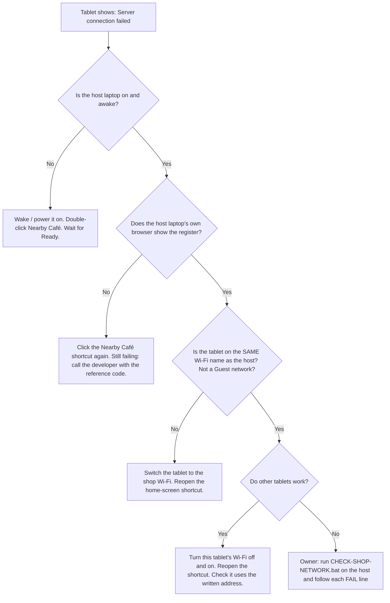

# Nearby Café: Start → Use → Stop

Your developer completes installation once. You do not need to open XAMPP or type commands for daily use.

1. **Start:** double-click the Nearby Café desktop shortcut. Wait through Checking setup, Starting database and Starting Nearby Café until Ready. The browser opens automatically. Clicking the shortcut again reuses the running app.
2. **Use:** sign in. Owners have Register and Management; Baristas use Register. Keep the host laptop awake and connected to the shop network. Pending means the order still needs server confirmation; do not charge it again as a new order after an interruption.
3. **Stop:** finish sales on all devices, then click Stop Nearby Café and confirm. Wait for Stopped. A shared database may stay running. Closing only the launcher window does not stop the app.

## Passwords and recovery

Use at least 12 characters. Very long passwords with accented letters or emoji can reach the technical storage limit sooner. Keep the exact password you entered; spaces are not removed.

After your initial sign-in, go to **Management → Account security** to prepare a recovery code. Save the displayed code offline with Copy or Download, or write it down carefully. You must confirm you saved it before closing. A replacement invalidates the earlier code.

- **Initial setup code:** supplied by the developer, used once to create the first Owner.
- **Owner recovery code:** prepared in Account security, used with Forgot password. Store it securely and never share it with staff.

Forgot the Owner password? Choose **Forgot password? → Owner/Admin recovery**, enter your username, saved recovery code and matching new passwords. Save the new replacement recovery code after success, then sign in. If the connection is lost, the result may already have committed: try the new password, then replace the recovery code in Account security after sign-in.

Baristas ask the Owner for a reset. Losing both the Owner password and recovery code requires authorized support. Do not delete the account or edit its database password field.

## If something goes wrong

Read the message and use Retry after its cause has been resolved. Share the reference code with your developer. Never send your password, setup code, recovery code, private configuration or database backup in a screenshot. Do not clear browser site data: it may contain pending orders.

The browser tab and desktop use the original café logo. If an old browser icon remains, press Ctrl+F5 and reopen the tab; do not erase site storage.

## Shop Wi-Fi: keep the tablets connected

The tablets only talk to the **host laptop**. Nothing goes over the internet, so an internet outage does **not** stop sales. They need three things:

1. They are on the **same Wi-Fi name** as the host laptop.
2. The router **lets devices see each other** (no "AP isolation", no "Guest network").
3. The host laptop keeps the **same address** every day.

The tablet address looks like `http://192.168.1.50:5174/`. Write yours here: `http://______________:5174/`

> **Why the address must never change:** each tablet keeps its unsent (Pending) orders under the exact address it uses. If the host gets a new address, the tablet opens a fresh, empty copy and the old pending orders are left behind under the old address. Reserve the address once (step B) and this never happens.

### A. Turn off "AP isolation" and do not use the Guest network

Many home and ISP routers have a privacy setting that blocks devices from seeing each other. Tablets then show **Server connection failed** even with full Wi-Fi bars.

1. On the host laptop, open a browser and go to the router page. It is printed on the sticker under the router, usually `192.168.0.1`, `192.168.1.1` or `192.168.100.1` (PLDT/Converge/Globe fibre routers often use `192.168.1.1` or `192.168.100.1`).
2. Sign in with the admin password from the sticker or from whoever installed the internet.
3. Find the setting by its name for your brand. Menu names change between models and firmware, so search the page for the words in **bold**.

| Router | Where to look | Set it to |
|---|---|---|
| **TP-Link** | Advanced → Wireless → Wireless Settings (or Additional Settings) → **AP Isolation** | Off / unticked |
| **D-Link** | Advanced → Advanced Wireless → **WLAN Partition** / **Wireless Isolation** | Off |
| **ASUS** | Wireless → Professional → **Set AP Isolated** (check each band: 2.4 GHz and 5 GHz) | No |
| **Huawei / ZTE / Fiberhome ISP router** | WLAN / Wireless → Advanced → **AP Isolation** / **SSID Isolation** | Off / Disabled |

4. **Guest network:** connect the tablets and the host laptop to the **main** Wi-Fi name, never a name ending in `-Guest`. Guest networks block local devices on purpose. On ASUS, Guest Network → Access Intranet only lets guests reach local devices if you switch it on. Don't do that: use the main network instead.
5. If the router shows both 2.4 GHz and 5 GHz names, either is fine as long as AP isolation is off on both.
6. Save, wait for the router to restart (about 1–2 minutes), then reconnect the tablets.

### B. Give the host laptop a permanent address (DHCP reservation)

A reservation tells the router: "always give this laptop the same address." It is safer than typing a fixed address into Windows, because the router will never hand that address to another device.

**First, on the host laptop:**

1. Make sure the Wi-Fi is set to **Private**: Settings → Network & internet → Wi-Fi → click the shop Wi-Fi name → Network profile type → **Private network**. (On Public, Windows blocks the tablets on purpose.)
2. On the same page, set **Random hardware addresses** to **Off** for this network. Otherwise the router sees a "new" laptop and the reservation doesn't work.
3. Double-click **CHECK-SHOP-NETWORK.bat** in the `rebuild` folder. Note the **TABLET ADDRESS** it shows.
4. Find the laptop's physical address (MAC): on the same Wi-Fi settings page, scroll to **Physical address (MAC)**. It looks like `A4-B1-C2-11-22-33`.

**Then, in the router:**

| Router | Where to look |
|---|---|
| **TP-Link** | Advanced → Network → DHCP Server → **Address Reservation** → Add |
| **D-Link** | Settings/Setup → Network Settings → **DHCP Reservation** → Add |
| **ASUS** | LAN → DHCP Server → **Manually Assigned IP around the DHCP list** → Yes → pick the laptop → Add (+) → Apply |
| **Huawei / ZTE / Fiberhome ISP router** | LAN → DHCP → **Static IP** / **DHCP Binding** / **Address Reservation** |

5. Choose the laptop from the device list, or type its MAC address. Use the **same address the laptop has now** (from step 3), so the tablets need no change.
6. Save. Restart the laptop once and run **CHECK-SHOP-NETWORK.bat** again: the address must be the same.
7. On each tablet, open that address and add it to the home screen. Always use this shortcut, never a different address.

> If the ISP router has no reservation option or is locked by the provider, ask your developer. A small router of your own (any TP-Link, D-Link or ASUS) behind the ISP modem works for the shop network.

### C. "Server connection failed": quick checks for baristas

Do **not** clear the browser, reinstall anything, or re-enter a Pending order as a new sale. Pending orders send themselves once the connection returns.

| Check | How | If it fails |
|---|---|---|
| 1. Host is on | Laptop screen on, not asleep, lid open (or set "do nothing when lid closed") | Wake it; start Nearby Café; wait for **Ready** |
| 2. App runs on host | The host's own browser shows the register | Click the shortcut again; note the reference code for the developer |
| 3. Same Wi-Fi | Tablet Wi-Fi name = host Wi-Fi name, not `-Guest` | Join the main shop Wi-Fi |
| 4. Right address | Tablet opens the written address `http://…:5174/` | Use the home-screen shortcut, not a typed or old address |
| 5. Only one tablet? | Other tablets work | Toggle the tablet's Wi-Fi; reboot the tablet; keep its browser data |
| 6. All tablets fail | Host works locally but no tablet connects | Owner runs **CHECK-SHOP-NETWORK.bat**: it checks Private profile, firewall rule, listening port and address |
| 7. After a router reset or new router | AP isolation may be back on; the reservation may be gone | Repeat sections A and B |

**Ping test (owner/developer):** on the host, the check tool already tests the address. To test from a laptop or phone on the same Wi-Fi, open Command Prompt and run `ping 192.168.1.50` (your host address). Replies but the app does not load → Windows firewall or the app (run CHECK-SHOP-NETWORK.bat). No replies → AP isolation, a Guest network, or a different Wi-Fi. Windows itself may ignore ping, so the browser address test above decides.
