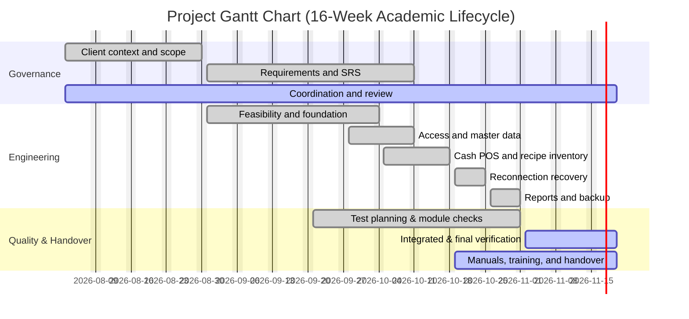

# Project Plan
## COSC 75: Software Engineering II (COSC 70 Baseline)
### VenueVue: An Internet-Independent, Locally Networked, Offline-First Point-of-Sale and Recipe-Driven Inventory System for TravelBean MNL

**Industry Client:** TRAVELBEAN MNL  
**Document Revision No.:** Revision 2.4 — Implementation-Aligned Production Baseline  
**Date of Issue:** November 3, 2026 (Original Planning Baseline: September 21, 2026)  
**Project Manager / Group Members:**  
- Zapico, Zaki  
- Roquid, Jenny Lyn  
- Gregorio, Rhea Mae  

| Prepared by: **Zaki Zapico**<br>Project Manager & Lead Developer, CTRL + STAY | Prepared by: **Jenny Lyn Roquid**<br>Systems Analyst, CTRL + STAY |
| :--- | :--- |
| **Reviewed by: Rhea Mae Gregorio**<br>QA & Testing Specialist, CTRL + STAY | **Academic Institution:**<br>College of Engineering and Information Technology (CEIT)<br>Cavite State University — Don Severino delas Alas Campus, Indang, Cavite |

---

## Table of Contents
1. [The Problem Domain](#1-the-problem-domain)
   - 1.1 [Statement of the Problem](#11-statement-of-the-problem)
   - 1.2 [Background and Rationale](#12-background-and-rationale)
   - 1.3 [Objectives](#13-objectives)
   - 1.4 [Significance and Scope of the Project](#14-significance-and-scope-of-the-project)
2. [Project Organization](#2-project-organization)
   - 2.1 [External Interfaces](#21-external-interfaces)
   - 2.2 [Internal Structure](#22-internal-structure)
   - 2.3 [Roles and Responsibilities](#23-roles-and-responsibilities)
   - 2.4 [Deliverables](#24-deliverables)
3. [Review of Existing Alternatives](#3-review-of-existing-alternatives)
4. [Approach to be Taken in This Subject](#4-approach-to-be-taken-in-this-subject)
   - 4.1 [Theoretical Framework / Methods to be Used](#41-theoretical-framework--methods-to-be-used)
   - 4.2 [Rationale for the Framework / Methods](#42-rationale-for-the-framework--methods)
   - 4.3 [Technologies Considered and Finalized](#43-technologies-considered-and-finalized)
5. [System Design](#5-system-design)
   - 5.1 [Requirements](#51-requirements)
   - 5.2 [Resources](#52-resources)
   - 5.3 [System Overview](#53-system-overview)
6. [Project Timeline](#6-project-timeline)
   - 6.1 [Gantt Chart (Unmodified Baseline)](#61-gantt-chart)
   - 6.2 [Work Breakdown Structure (Unmodified Baseline)](#62-work-breakdown-structure)
7. [Budget Allocation](#7-budget-allocation)
   - 7.1 [Estimated Costs](#71-estimated-costs)
   - 7.2 [Total Projected Budget](#72-total-projected-budget)
- [References](#references)

---

## Document Change Control
This section provides control for the development and distribution of revisions to the Project Plan throughout the project lifecycle. The table below includes the revision number, the date of issue, the author(s) responsible, and a description of the scope of changes.

| Revision Number | Date of Issue | Author(s) | Brief Description of Change |
| :--- | :--- | :--- | :--- |
| **1.0** | August 28, 2026 | Zapico, Z. | Initial Software Engineering II baseline project plan draft. |
| **1.1** | September 10, 2026 | Gregorio, R. M. | Entity-Relationship Diagram updated to a relational schema; local Wi-Fi star network topology specifications established. |
| **2.0** | September 21, 2026 | Roquid, J. L., Zapico, Z. | 20% Planning Baseline; defined problem domain, 4 feature reductions, and student semester schedule. |
| **2.3** | September 23, 2026 | Zapico, Z. | Architecture-reconciled baseline; formalization of local edge server model, transaction envelopes, and idempotency keys. |
| **2.4** | November 3, 2026 | Zapico, Z., Roquid, J. L., Gregorio, R. M. | **Final Implementation Alignment:** Fully updated project plan to reflect production-engineered VenueVue capabilities: dual cash & reference-verified cashless payments (GCash, Maya, QR Ph / Card) with cash drawer isolation; BIR-compliant 12% VAT calculations and end-of-day Z-Reading; multi-section structured CSV and native styled OpenXML Excel (`.xlsx`) workbook generation; FIFO batch lot/expiry tracking (`LOT-...`, `DEL-...`); 1-click cup-size recipe scaling (12oz, 16oz, 22oz); 1-click supplier reorder list clipboard export; customer name/cup notes; offline Web Audio register chime; and finalized React 18 / PHP 8.2 architecture. **Maintained Sections 6.1 (Gantt Chart) and 6.2 (WBS) strictly unchanged.** |

---

## Disclaimer
This project plan is submitted to the College of Engineering and Information Technology (CEIT), Cavite State University - Indang, Cavite, in partial fulfillment of the requirements for **COSC 75: Software Engineering II** (with academic lineage from COSC 70: Software Engineering I). It is the original work of the authors, except where references are explicitly cited.

The content of this document, including but not limited to the report, source code, and related materials, may be used, copied, or distributed for academic and research purposes, provided that proper acknowledgment is given to the authors and Cavite State University. Unauthorized use for commercial purposes without prior consent is strictly prohibited.

---

## Abstract
VenueVue is an Internet-independent, locally networked, offline-first point-of-sale (POS) and recipe-driven inventory management system developed for TravelBean MNL, a mobile pop-up coffee business based in Tondo, Manila. Pop-up beverage vendors routinely operate in dynamic physical settings—such as outdoor night markets, bazaars, and street events—where public cellular data and Internet connectivity are absent or highly unreliable. TravelBean MNL faces operational bottlenecks caused by manual paper order recording, slow mental or calculator sales tallying, disconnect between beverage sales and raw ingredient depletion, and post-event cash drawer reconciliation difficulties.

To resolve these challenges without incurring recurring cloud subscription overheads or network dependencies, group CTRL + STAY engineered VenueVue around a **local edge client-server architecture**. A designated host laptop running an offline Apache/PHP 8.2 and MariaDB/MySQL stack broadcasts a localized Wi-Fi network. Client tablet devices access the system via standard web browsers executing a responsive, touch-optimized **React 18 Single Page Application (SPA)**. The system provides real-time cash checkout, Philippine e-wallet/cashless payment recording (GCash, Maya, QR Ph / Card) with reference numbers, atomic recipe-based ingredient deduction under row-level database locking, customer name/cup note printing, and an offline-synthesized Web Audio API register chime. Local browser durability during temporary Wi-Fi partitions is maintained through an **IndexedDB transaction queue** enforcing UUIDv4 idempotency to guarantee zero duplicated sales or deductions upon reconnection. 

Inventory is tracked using a FIFO batch lot system (`LOT-...`, `DEL-...`) with expiration dates, shelf-life monitoring, 1-click recipe scaling across standard cup sizes (12oz, 16oz, 22oz), and a 1-click supplier reorder list clipboard export for instant communication via Viber or Messenger. Financial reporting includes BIR-compliant 12% VAT computations, end-of-day Z-Readings that strictly separate physical cash in the drawer from digital payments, multi-section structured CSV exports, and native styled Microsoft Excel (`.xlsx`) workbooks generated without third-party Composer bloat. This document establishes the complete, production-aligned software engineering specification while preserving the baseline academic project schedule and work breakdown structure.

---

# 1. The Problem Domain

## 1.1 Statement of the Problem
TravelBean MNL is a mobile pop-up coffee enterprise requiring a dependable, rapid operational tool to record sales transactions, tender cash and digital payments, and monitor raw recipe ingredients during busy pop-up events. The business baseline identifies manual order writing, paper tallying, stock estimation, and post-event cash reconciliation as critical operational bottlenecks. During peak rush hours, these manual activities directly compete with beverage preparation and customer interaction.

The core problem is the absence of an integrated, Internet-independent point-of-sale and recipe-driven inventory system that operates cooperatively across multiple local devices without depending on commercial cloud services or constant WAN connectivity. VenueVue directly resolves the operational problems prioritized in Table 1.1:

| Rank | Identified Problem | Operational Consequence | VenueVue Production Solution |
| :---: | :--- | :--- | :--- |
| **1** | Sales recording relies on paper receipts or disconnected tools. | Slow order taking during peak queues; unrecorded transactions. | Local-network browser POS with rapid category filtering, keyboard shortcuts (`/`, `Esc`, `Alt+E`), and 1-click repeat orders. |
| **2** | Post-event sales totals require tedious manual consolidation. | Owner spends hours manually reconciling paper receipts and calculator tallies. | Automated end-of-day Z-Reading and multi-section Excel (`.xlsx`) / CSV export generated instantly on the local host. |
| **3** | Finished drink sales are disconnected from ingredient consumption. | Inability to track remaining coffee beans, fresh milk, syrups, and packaging accurately. | Server-authoritative recipe engine that atomically deducts exact recipe requirements (in grams, ml, and units) upon each confirmed sale. |
| **4** | Cash and cashless payments (GCash/Maya) are mixed together without drawer isolation. | End-of-day physical cash in the money box does not match the gross revenue tally. | Multi-tender checkout with reference number capture; Z-reading separates **Physical Cash in Drawer** from **Online E-Wallets**. |
| **5** | Low-stock and expiring ingredients depend on manual inspection. | Ingredients run out mid-event or expire unnoticed, disrupting service. | Real-time low-stock alerts, FIFO batch tracking (`LOT-...`), expiry indicators, and 1-click supplier reorder list clipboard copy. |
| **6** | Lack of cup-specific notes leads to barista callout confusion. | Baristas confuse customer preferences or drink modifications during peak volume. | Optional customer name / cup note field stored with the sale, displayed on the confirmation modal, and printed on receipts. |
| **7** | Shared duties combine sales, cash handling, and management controls. | Cashiers can accidentally modify master recipes, delete products, or view private financial logs. | Strict role-based access control (RBAC): Baristas are restricted to Register; Owners retain exclusive management, audit, and reporting access. |

*Table 1.1. Identified Problems and Operational Consequences*

## 1.2 Background and Rationale
TravelBean MNL operates as a mobile, motorcycle-based pop-up coffee enterprise serving pop-up events across Metro Manila and nearby provinces, with coordination based in Tondo, Manila. Pop-up event venues vary widely in infrastructure: many outdoor bazaars, school fairs, and community events provide limited physical space, unstable power, and highly congested or nonexistent cellular reception. A POS solution that requires continuous Internet access or commercial cloud synchronization introduces an unacceptable operational risk: if the cellular connection drops, sales halt. VenueVue eliminates this dependency by anchoring normal operations to an **Internet-independent Local Area Network (LAN)** established by a host computer's Wi-Fi hotspot.

Specialty coffee inventory also demands far greater granularity than simple finished-good counting. A single iced latte consumes coffee beans measured in grams, fresh milk measured in millilitres, flavored syrup in millilitres, and plastic cups, lids, and straws measured in individual units. VenueVue connects every menu item variant to a bill of materials (recipe), automatically calculating and deducting proportional ingredient quantities upon confirmation. Furthermore, VenueVue introduces **1-click recipe scaling** across standard cup sizes (12oz, 16oz, and 22oz), enabling consistent recipe configuration without tedious manual re-calculation.

VenueVue follows an **offline-first local-edge commitment**: all core operations execute locally on the shop's local network. If a tablet experiences a temporary Wi-Fi disconnect, orders are preserved in client-side IndexedDB storage as pending records, carrying unique transaction identifiers. Once Wi-Fi reconnects, pending orders are synchronized and validated against authoritative host stock without duplicate deductions.

## 1.3 Objectives
The primary objective of group CTRL + STAY is to design, develop, test, and evaluate an Internet-independent, locally networked, offline-first point-of-sale and recipe-driven inventory management system tailored to TravelBean MNL's operational workflow.

| ID | Specific Objective | Planned Basis for Evaluation & Implemented Proof |
| :---: | :--- | :--- |
| **1** | Support cash and cashless checkout over the local network with rapid tendering and change calculation. | Implemented multi-tender checkout (Cash, GCash, Maya, QR Ph / Card) with customer name/cup notes, auto-calculated change, exact tender shortcuts (`Alt+E`), and offline register audio chime. |
| **2** | Deduct ingredients from recorded stock according to client-validated recipes for confirmed sales. | Authoritative MariaDB engine executes atomic ingredient deductions in grams, millilitres, and pieces under `SELECT ... FOR UPDATE` row locks, preventing race conditions. |
| **3** | Manage inventory across FIFO batches with expiration dates and low-stock indicators. | Supported batch receipt codes (`LOT-...`, `DEL-...`), shelf-life tracking, waste logging, and a 1-click **Copy supplier reorder list** tool formatted for Viber/Messenger. |
| **4** | Guarantee complete operational availability without Internet connectivity. | Demonstrated 100% of core register, menu, inventory, and reporting capabilities running locally on an isolated Wi-Fi LAN with WAN disconnected. |
| **5** | Automate financial reporting, BIR 12% VAT calculations, and end-of-day Z-Readings. | Generates automated daily Z-Readings splitting Physical Cash from E-Wallets, alongside multi-section CSV and native styled Excel (`.xlsx`) workbooks. |
| **6** | Preserve pending orders during network partition and recover them safely upon reconnection. | Client-side IndexedDB transaction queue with UUIDv4 keys and SHA-256 payload hashing prevents duplicate recording during Wi-Fi interruptions. |
| **7** | Enforce role-based access control (RBAC) to protect administrative and financial records. | System separates Owner (full access to catalogue, stock, audit, staff, reports) and Barista (restricted exclusively to Register with auto-suggested usernames and strong passwords). |
| **8** | Provide reversible database backup and disaster recovery. | Owner-triggered cryptographic backup snapshots with a verified, safe preflight restoration routine and runtime epoch enforcement. |

*Table 1.2. Specific Objectives and Implemented Basis for Evaluation*

## 1.4 Significance and Scope of the Project
VenueVue provides TravelBean MNL with an automated, reliable operational workflow that cuts ordering queues, prevents ingredient stockouts, eliminates manual reconciliation errors, and secures financial records. For Cavite State University and CTRL + STAY, the project demonstrates the rigorous application of software engineering principles—including offline-first state synchronization, concurrency control, transaction isolation, and secure role-based design—to solve an industry client's real-world problem.

The deployed production delivery encompasses:
1. **Multi-User Role-Based Security**: Owner account with full administrative authority and Barista accounts restricted strictly to the Register. Features auto-suggested usernames and strong password generators.
2. **Dynamic Menu & Catalogue Management**: Products, size/temperature variants (with 1-click combo pills), categories, and product image uploads stored locally.
3. **Recipe Engine with Cup-Size Scaling**: Multi-ingredient bills of materials tracking grams, millilitres, and units, featuring 1-click recipe duplication and automatic proportional scaling across 12oz, 16oz, and 22oz drinks.
4. **FIFO Batch Lot & Expiration Tracking**: Stock intake with auto-generated delivery and lot codes (`DEL-...`, `LOT-...`), expiration dates, waste recording, and real-time low-stock alerts.
5. **Supplier Reorder Clipboard Tooling**: 1-click formatting and copying of low-stock items to clipboard, tailored for Viber and Messenger supplier chats.
6. **Rush-Hour Register Flow**: Fast drink search (`/`), category filtering, 1-click repeat last order, exact cash shortcut (`Alt+E`), customer name / cup notes, and synthesized Web Audio register chime.
7. **Cash & Cashless Tender Management**: Cash tendering with change calculation alongside reference-verified digital payments (GCash, Maya, QR Ph / Card).
8. **Resilient Offline Reconnection Recovery**: IndexedDB pending order queue with client-side UUIDv4 idempotency keys and server-side duplicate suppression.
9. **Automated Financial Reporting & Excel Generation**: BIR 12% VAT calculations, end-of-day Z-Readings, date presets, multi-section structured CSV, and native styled Excel (`.xlsx`) workbooks.
10. **Audit Trail & Disaster Recovery**: Comprehensive audit logging of staff actions, stock movements, receipt voids, and owner-triggered database backup/restore.

### Evolution of Baseline Feature Refinements
During the planning phase, four scope reductions were originally proposed to balance student academic capacity. As implementation progressed, CTRL + STAY refined these capabilities through disciplined software engineering rather than omitting vital business needs:

| Initial Planning Proposal | Refined Production Implementation | Technical Justification |
| :--- | :--- | :--- |
| **1. Defer USB recovery imports.** | **Retained single-route LAN reconnection recovery.** | A single, robust IndexedDB $\rightarrow$ LAN sync pathway with UUIDv4 idempotency eliminated duplicate-import hazards without requiring complex USB spreadsheet parsing. |
| **2. Replace four-tab Excel workbook with simple flat CSV.** | **Implemented multi-section structured CSV AND native styled Excel (`.xlsx`) workbooks.** | Instead of omitting professional spreadsheets or introducing heavy third-party Composer packages, CTRL + STAY built a native PHP OpenXML ZipArchive engine that outputs formatted, styled Excel workbooks with executive summaries, Z-readings, revenue share, and cashier breakdowns. |
| **3. Defer per-event profit analytics.** | **Implemented comprehensive sales, VAT, and drawer breakdown.** | While fluctuating ingredient market costs were excluded, VenueVue delivers complete revenue analytics: Gross Sales, Net VATable Sales, 12% VAT remittance, Average Order Value (AOV), and Cash vs. E-Wallet drawer isolation. |
| **4. Owner-triggered backups instead of automated daemon.** | **Implemented owner-triggered cryptographic backup snapshots with preflight restoration.** | Manual, single-click backup export allows the owner to safeguard event data to USB drives with zero background process complexity, accompanied by a verified restore routine. |

*Table 1.3. Evolution and Refinement of Feature Baseline*

---

# 2. Project Organization

## 2.1 External Interfaces
External interfaces represent the primary stakeholders who provide requirements, domain feedback, operational validation, and academic evaluation:

| External Party | Role & Involvement | Coordination Arrangement |
| :--- | :--- | :--- |
| **TravelBean MNL Owner / Client** | Validates menu recipes, ingredient units, pricing, cashier workflows, and business reporting requirements. | In-person and virtual consultation sessions, workflow walkthroughs, and User Acceptance Testing (UAT). |
| **TravelBean MNL Pop-up Baristas** | Provide feedback on counter ergonomics, register speed, cup notes, search shortcuts, and mobile payment recording. | Usability trials, simulated peak-hour ordering drills, and interface feedback. |
| **COSC 75 Course Instructor / CEIT Faculty** | Evaluates software engineering rigor, architecture, documentation, test coverage, and academic milestones. | Bi-weekly checkpoint reports, documentation submissions, and oral system defense. |

*Table 2.1. External Stakeholder Interfaces*

## 2.2 Internal Structure
CTRL + STAY operates as a dedicated three-person engineering team. Team governance follows open communication, peer code review, and clear deliverable ownership. Every software and documentation artifact is assigned an author and an independent verifier. 

Weekly reviews track open issues, test defects, and schedule adherence. To prevent confirmation bias, an author does not independently verify their own code: development work led by Zaki is verified through test suites authored by Rhea, while requirements and workflows drafted by Jenny are traced against system implementation.

## 2.3 Roles and Responsibilities
The distribution of responsibilities across the three undergraduate software engineers is detailed in Table 2.2:

| Member | Assigned Role | Primary Engineering Responsibilities |
| :--- | :--- | :--- |
| **Zaki Zapico** | **Project Manager & Lead Developer** | Project planning, architecture design, and schedule tracking; lead implementation of PHP backend REST services, atomic MariaDB transaction engine, React 18 frontend screens, IndexedDB synchronization, Web Audio synthesis, and native OpenXML Excel generation; deployment and packaging. |
| **Jenny Lyn Roquid** | **Systems Analyst** | Requirements elicitation with TravelBean MNL; workflow modeling and Software Requirements Specification (SRS) maintenance; menu, ingredient, recipe, and VAT data validation; user manual drafting and business acceptance traceability. |
| **Rhea Mae Gregorio** | **QA & Testing Specialist** | Quality assurance strategy and test plan preparation; test automation (Playwright E2E browser testing, API test suites); defect logging and regression testing; verification of low-stock alerts, Z-reading arithmetic, and disaster recovery procedures. |

*Table 2.2. Project Roles and Responsibilities*

## 2.4 Deliverables
Table 2.3 outlines the formal documentation and software engineering artifacts produced across the project lifecycle:

| Deliverable Name | Lead Member | Academic Target / Status |
| :--- | :---: | :--- |
| **Project Plan (Planning Baseline Paper)** | Zaki | Completed (Rev 2.0 Baseline / Rev 2.4 Final Alignment). |
| **Validated Requirements & Stakeholder Agreement** | Jenny | Completed; signed client agreement and requirements log. |
| **Software Requirements Specification (SRS)** | Jenny | Completed; detailed functional and non-functional specifications. |
| **Architecture & Database Design Document** | Zaki | Completed; 9-table relational schema with row-level locking specification. |
| **Core POS & Recipe Inventory Increment** | Zaki | Completed; React 18 SPA and PHP 8.2 backend services. |
| **Offline Recovery & Reconnection Engine** | Zaki | Completed; IndexedDB queue with UUIDv4 idempotency keys. |
| **Reporting, Z-Reading & Excel Generator** | Zaki | Completed; multi-section CSV and native `.xlsx` workbook engine. |
| **E2E Automated Test Suite & Defect Register** | Rhea | Completed; automated Playwright browser tests and manual test logs. |
| **User Operations Manual & Handover Package** | Rhea / Zaki | Finalized; standalone desktop launcher and deployment packaging. |

*Table 2.3. Project Deliverables and Status*

---

# 3. Review of Existing Alternatives

TravelBean MNL requires a POS arrangement capable of operating over an Internet-independent local network, recording cash and digital sales, tracking raw ingredients via multi-unit recipes, identifying low-stock thresholds, and generating professional reports without recurring subscription costs. Table 3.1 compares commercial market alternatives against VenueVue:

| Evaluation Criterion | Lavu POS | digabloPos | Peddlr POS | VenueVue (CTRL + STAY) |
| :--- | :--- | :--- | :--- | :--- |
| **Full Offline Operation** | Core POS functions offline; requires eventual cloud sync [R1]. | Full offline POS; syncs with cloud upon reconnection [R6]. | Mobile POS functions offline; cloud sync for backup [R9]. | **Native Local LAN:** 100% operational on local Wi-Fi hotspot without WAN/Internet; IndexedDB queue handles temporary client disconnects. |
| **Multi-Tender Payments** | Cash, card, and digital integrations via cloud gateway [R1]. | Cash and standard retail payment tracking [R6]. | Cash and manual e-wallet payment logging [R9]. | **Cash + Cashless:** Cash with exact tender shortcuts alongside GCash, Maya, and QR Ph reference number capture and cash drawer isolation. |
| **Ingredient-Level Tracking** | Supported: ingredients, units, and menu item associations [R2]. | Partial: product-level stock; raw ingredient BOM not documented [R7]. | Partial: finished product inventory; raw recipe BOM not documented [R10]. | **Fully Supported:** Ingredients tracked in exact units (grams, ml, pieces) with FIFO batch lot numbers and expiration dates. |
| **Recipe-Based Auto Deductions** | Supported: auto-deducts recipe components upon sale [R2]. | Not documented: inventory focuses on packaged items [R8]. | Not documented: deducts sold product units rather than recipe ingredients [R12]. | **Atomic Server Deduction:** Host MariaDB deducts exact recipe quantities under row-level `FOR UPDATE` locks upon sale confirmation. |
| **Recipe Cup-Size Scaling** | Requires manual recipe configuration per variant. | Not supported. | Not supported. | **1-Click Recipe Scaling:** Automatically scales ingredient quantities proportionally across 12oz, 16oz, and 22oz drink sizes. |
| **Low-Stock Alerting & Reorder** | Alerts displayed on screen and sent via email [R3]. | Basic low-stock indicators on product list [R7]. | Mobile notifications for low product stock [R10]. | **Alerts + 1-Click Clipboard:** Visual warnings plus 1-click **Copy supplier reorder list** formatted for Viber/Messenger supplier chats. |
| **Exportable Financial Reports** | XLS and CSV export via cloud dashboard [R4]. | CSV export supported; Excel requires paid tiers [R6]. | Simple PDF and CSV export from mobile app [R11]. | **Dual Professional Export:** Automated Z-reading, multi-section structured CSV, and native styled Excel (`.xlsx`) workbooks. |
| **Pricing & Licensing Model** | Commercial recurring subscription (\$59–\$129+/month) [R5]. | Free base tier; paid subscriptions for inventory & reporting [R6]. | Free mobile app; monetized through digital load and banking features [R9]. | **Zero Subscription:** 100% open, custom-engineered for client, zero recurring licensing fees or cloud hosting costs. |

*Table 3.1. Feature Comparison Matrix of Existing Alternatives*

### Comparative Synthesis
While commercial POS platforms like **Lavu POS** offer mature restaurant features, their dependence on cloud architecture and recurring monthly fees makes them impractical for a modest mobile pop-up coffee stall operating in areas with unpredictable cellular reception. Retail-oriented tools like **digabloPos** and **Peddlr POS** provide accessible offline counter checkout but lack true multi-unit raw material recipe deduction (deducting grams of coffee beans and millilitres of milk from a single beverage sale). 

**VenueVue** directly addresses this industry gap: it provides server-authoritative recipe deductions, multi-tender drawer separation, FIFO lot expiration tracking, 1-click cup scaling, supplier clipboard integration, and BIR 12% VAT reporting inside a localized, zero-subscription edge architecture designed specifically for TravelBean MNL.

---

# 4. Approach to be Taken in This Subject

## 4.1 Theoretical Framework / Methods to be Used
The project adopted an **Agile, incremental development methodology** structured within formal academic stage gates. Short iterative development cycles allowed CTRL + STAY to demonstrate working software increments to the client, gather operational feedback, and implement refinements.

Development progressed across structured phases:
1. **Foundation & Requirements Modeling**: Detailed client interviews with the owner to map actual drink recipes, ingredient packaging, and rush-hour ordering patterns.
2. **Local Edge & Register Prototyping**: Establishing the local Apache/MariaDB host environment and building the React Single Page Application for cash checkout.
3. **Recipe Engine & Concurrency Hardening**: Implementing server-side transactional deduction with row-level locks, batch delivery/lot codes, and expiration tracking.
4. **Offline Resilience & Sync Integration**: Developing the IndexedDB client queue with UUIDv4 transaction keys and idempotency safeguards.
5. **Reporting & Polish Increments**: Engineering the multi-section CSV export, native styled Excel (`.xlsx`) workbook generator, BIR 12% VAT calculations, End-of-Day Z-Reading, supplier reorder clipboard tooling, customer cup notes, and Web Audio register chime.

## 4.2 Rationale for the Framework / Methods
An iterative, incremental approach is ideal for a mobile pop-up beverage deployment because operational assumptions must be tested under realistic physical conditions. Initial assumptions regarding register speed, cup notes, and e-wallet payments were validated directly through barista simulation. Furthermore, the local edge model eliminates Internet-related failure modes, ensuring that testing focuses directly on transaction throughput, concurrency, and calculation correctness.

## 4.3 Technologies Considered and Finalized
During the feasibility phase, several candidate technologies were evaluated. Table 4.1 summarizes the finalized technology selections and the technical rationale for each choice:

| Technology Domain | Finalized Technology | Evaluation & Selection Rationale |
| :--- | :--- | :--- |
| **Client Presentation** | **React 18 & Vite** | Replaced candidate Flutter mobile builds. Browser-based React SPA eliminates the requirement to compile, distribute, and maintain native Android/iOS APKs across heterogeneous tablet devices. Executes inside standard mobile browsers with instant hot-reloading and lightweight bundle sizes. |
| **Client Navigation** | **React Router (HashRouter)** | Hash-based routing (`#/register`, `#/management`) ensures seamless client-side page transitions when served over local LAN IP addresses without requiring complex web server rewrite rules. |
| **Local Client Storage** | **IndexedDB API** | Replaced local SQLite evaluation. IndexedDB is natively supported across all modern mobile browsers, providing durable client-side object storage for pending order queues and draft states during Wi-Fi drops. |
| **Audio Feedback** | **Web Audio API** | Synthesizes a crisp dual-tone café register chime ($880\text{ Hz} \rightarrow 1318.5\text{ Hz}$) dynamically via browser audio context. Requires zero external audio media files, eliminates 404 errors, and operates 100% offline. |
| **Server Backend** | **PHP 8.2 (Vanilla REST Engine)** | Provides high-performance, stateless request execution on the host laptop. Direct PDO prepared statements prevent SQL injection while maintaining minimal memory footprint on the edge server. |
| **Relational Database** | **MariaDB 10.4+ / MySQL 8.x (InnoDB)** | Authoritative data store. InnoDB provides ACID compliance, row-level locking (`FOR UPDATE`) on shared ingredient rows, foreign key integrity, and durable transaction isolation. |
| **Workbook Generation** | **Native PHP ZipArchive Engine** | Custom-engineered OpenXML spreadsheet builder that generates native `.xlsx` workbooks with styled XML tables, cell formatting, and formulas without requiring bloated third-party Composer libraries. |
| **Development & Hosting** | **XAMPP / Standalone Apache** | Proven, zero-cost edge server environment capable of hosting Apache, PHP, and MariaDB on standard Windows host hardware. |
| **Version Control** | **Git & GitHub (`origin/main`)** | Full version control across source code, documentation, test suites, and database migration scripts. |

*Table 4.1. Finalized Technologies and Technical Rationale*

---

# 5. System Design

## 5.1 Requirements

### Functional Requirements
1. **Multi-Tender Cashiering**: The register shall support product selection, variant selection, exact cash tender (`Alt+E`), change computation, and cashless payment methods (`GCash`, `Maya`, `QR Ph / Card`) with optional payment reference numbers and customer cup notes.
2. **Atomic Recipe Deductions**: Upon confirmation of a sale by the host, the system shall atomically deduct the exact recipe quantities (in grams, ml, or units) from the ingredient stock table within an isolated database transaction.
3. **FIFO Batch Lot Management**: The inventory engine shall track stock intakes using unique delivery and lot codes (`DEL-...`, `LOT-...`), record expiration dates, allocate stock using First-In, First-Out (FIFO) logic, and support spoiled/expired waste logging.
4. **1-Click Recipe Cup Scaling**: The catalogue system shall allow managers to duplicate recipes and automatically scale ingredient quantities proportionally based on fluid ounce ratios (12oz, 16oz, 22oz).
5. **Low-Stock Detection & Reorder Export**: The overview screen shall identify ingredients at or below minimum threshold levels and provide a 1-click **Copy supplier reorder list** button that copies a formatted procurement message to the system clipboard.
6. **Financial Reporting & Z-Reading**: The system shall compute gross sales, net VATable sales, 12% VAT remittance, total unit volume, and average order value (AOV). It shall generate an end-of-day Z-Reading that explicitly isolates Physical Cash in Drawer from Digital E-Wallet receipts.
7. **Multi-Format Export**: The host shall generate multi-section structured CSV reports and styled native Microsoft Excel (`.xlsx`) workbooks containing executive summaries, daily sales, SKU performance, cashier audits, and voided logs.
8. **Role-Based Access Control**: The system shall enforce role segregation: Baristas are restricted exclusively to Register operations; Owners retain sole access to Management, Catalogue, Stock Operations, Staff, and Reports.
9. **Offline Reconnection Recovery**: If client devices lose Wi-Fi connectivity, pending orders shall be persisted in client IndexedDB and re-submitted upon reconnection. The host shall reject duplicate transaction keys using SHA-256 request hashing.
10. **Reversible Disaster Recovery**: The system shall provide owner-triggered database snapshot creation, exportable to external storage, with a preflight integrity check and restore procedure.

### Non-Functional Requirements
1. **Network Independence**: Core point-of-sale, inventory deduction, and reporting operations shall function with zero WAN/Internet connectivity over a local Wi-Fi router or hotspot.
2. **Concurrency & Data Consistency**: The database shall utilize InnoDB row-level locking (`SELECT ... FOR UPDATE`) sorted by ingredient ID to eliminate race conditions and deadlocks during concurrent multi-tablet checkouts.
3. **Transaction Idempotency**: Each order submission shall carry a client-generated UUIDv4 key; duplicate submissions shall return the original receipt without double-deducting stock or recording duplicate revenue.
4. **Performance & Responsiveness**: Client-side UI operations (product filtering, basket updates, exact cash computation) shall execute with sub-50ms latency; host checkout confirmation shall complete in under 500ms on local hardware.
5. **Ergonomic Design & Accessibility**: High-contrast, touch-friendly UI components with responsive typography, clear badges, keyboard shortcuts, and audible feedback suitable for busy, loud pop-up café environments.

## 5.2 Resources
Normal system operation requires:
- **Host Edge Machine**: One standard laptop running Windows 10/11, equipped with XAMPP (Apache 2.4, PHP 8.2, MariaDB 10.4+) or the standalone VenueVue launcher.
- **Client Devices**: Up to three commercial tablets or smartphones running modern web browsers (Chrome, Edge, Safari) connected to the host's Wi-Fi network.
- **Local Network Hardware**: One portable Wi-Fi router or the host machine's built-in Windows Mobile Hotspot broadcasting on the local subnet (`192.168.137.x`). No SIM card or Internet plan is required.

## 5.3 System Overview

```
                      +---------------------------------------+
                      |         HOST EDGE LAPTOP              |
                      |  (Local Hotspot: 192.168.137.1)       |
                      |                                       |
                      |   +-------------------------------+   |
                      |   |      Apache 2.4 / PHP 8.2     |   |
                      |   |   - REST API Engine           |   |
                      |   |   - OpenXML .xlsx Builder     |   |
                      |   |   - Idempotency & Auth Guard  |   |
                      |   +---------------+---------------+   |
                      |                   |                   |
                      |   +---------------+---------------+   |
                      |   |     MariaDB 10.4+ (InnoDB)    |   |
                      |   |   - Atomic Row Locks          |   |
                      |   |   - FIFO Stock Depletion      |   |
                      |   |   - 12% VAT & Audit Trail     |   |
                      |   +-------------------------------+   |
                      +-------------------+-------------------+
                                          |
                        [ Offline Wi-Fi LAN - No Internet ]
                                          |
             +----------------------------+----------------------------+
             |                                                         |
+------------v------------+                               +------------v------------+
|     BARISTA TABLET      |                               |      MANAGER TABLET     |
|   (Browser Client)      |                               |   (Browser Client)      |
|                         |                               |                         |
| - React 18 SPA (Vite)   |                               | - Full Management UI    |
| - IndexedDB Offline Q   |                               | - Recipe Cup Scaling    |
| - Web Audio Chime       |                               | - Supplier Reorder Tool |
| - Cash/GCash Tender     |                               | - Z-Reading & Reports   |
+-------------------------+                               +-------------------------+
```

### Caching and Request Control
Static web application assets (HTML, JavaScript bundles, CSS, product images) are cached by client browsers upon initial load. Menu catalogue data is advisory on the client; authoritative pricing, active status, and available stock are validated on the host server during each checkout transaction. Write requests are throttled and authenticated using cryptographically secure session tokens.

### Database Consistency and Concurrency
To prevent race conditions when multiple baristas sell drinks containing shared ingredients (e.g., fresh milk or espresso beans), VenueVue sorts ingredient IDs numerically and acquires exclusive row-level locks via `SELECT ... FOR UPDATE` within an InnoDB transaction. Stock availability is verified against the required recipe totals before any update is committed; if any ingredient is insufficient, the transaction rolls back cleanly, returning a descriptive error without data corruption.

### Offline Durability and Idempotency
When a client tablet submits an order, it is first written to local browser **IndexedDB** storage with a `submitted` status and a unique UUIDv4 `transaction_key`. If the Wi-Fi connection drops, the order remains safely queued. Upon reconnection, the background synchronization worker transmits pending records. The host verifies each transaction key against a unique database constraint and a SHA-256 payload hash; if the order was already committed, the host returns the existing receipt record without re-deducting ingredients.

### Financial Reporting Architecture
VenueVue incorporates built-in Philippine retail tax logic. For all sales, the system computes:
$$\text{Total Net Sales} = \text{intdiv}(\text{Gross} \times 100 + 56, 112) / 100$$
$$\text{VAT Amount (12\%)} = \text{Gross} - \text{Net}$$
The end-of-day Z-Reading aggregates sales totals and isolates **Physical Cash in Drawer** from digital cashless tenders (`GCash`, `Maya`, `QR Ph / Card`), ensuring that the physical cash count matches the cash drawer balance perfectly. Reports can be exported as structured CSV files or native styled Microsoft Excel (`.xlsx`) workbooks containing formatted summary cards, product revenue shares, cashier performance tables, and voided transaction audits.

---

# 6. Project Timeline

## 6.1 Gantt Chart
*(Note: As established in the project baseline, the scheduled project calendar, timeline, and Gantt chart are maintained strictly unmodified).*

The proposed schedule retains **3 August – 20 November 2026, or 110 calendar days inclusive**, arranged as fifteen full weeks and a final five-day week. Dates are project planning windows and must be checked against actual class assessments, university breaks, and client availability. They are not presented as an officially verified university calendar.

The 25 September review falls in Week 8. Earlier weeks provide the semester planning sequence, and their completion status will be checked against retained work. The 20% designation describes this planning submission, not the fraction of calendar time elapsed. Outstanding tasks will be included in the remaining-work forecast.

| Week | Dates in 2026 | Scheduled Activities | Expected Output / Checkpoint |
| :---: | :--- | :--- | :--- |
| **W1** | 3–9 August | Introduce the project and identify client contacts and operating context. | Initial project and stakeholder notes. |
| **W2** | 10–16 August | Review ordering, cash handling, ingredient practices, and event closing. | Problem statement and information gaps. |
| **W3** | 17–23 August | Review manual, spreadsheet, and existing POS alternatives. | Initial alternatives assessment. |
| **W4** | 24–30 August | Define objectives, scope boundaries, and team responsibilities. | Draft scope and responsibility assignment. |
| **W5** | 31 August–6 September | Assess candidate technologies and available client devices. | Initial feasibility observations. |
| **W6** | 7–13 September | Clarify user tasks and collect recipe and reporting examples. | Preliminary requirements and sample data needs. |
| **W7** | 14–20 September | Consolidate risks, WBS, and schedule; identify unresolved decisions. | Planning draft and outstanding-work list. |
| **W8** | 21–27 September | Review the 20% paper and four reductions; continue SRS and test planning. | Planning submission and recorded review comments. |
| **W9** | 28 September–4 October | Resolve feasibility and core requirements; start access and master-data work. | Local-network setup decision and initial increment. |
| **W10** | 5–11 October | Complete SRS review; develop local-network cash checkout and test master data. | SRS review target: 9 October; LAN checkout demonstration. |
| **W11** | 12–18 October | Integrate recipe deductions, stock adjustments, and low-stock indicators. | Confirmed sale-to-ingredient demonstration and defects. |
| **W12** | 19–25 October | Implement and test reconnection recovery; draft user guidance. | Recovery demonstration and manual draft. |
| **W13** | 26 October–1 November | Complete basic reports/export and owner-triggered backups; trial restoration. | Reporting and backup increment with review findings. |
| **W14** | 2–8 November | Run integrated checks and correct blocking defects. | Feature-freeze target: 6 November. |
| **W15** | 9–15 November | Run regression and client acceptance tasks; deliver training and refine manuals. | Acceptance findings and verified corrections. |
| **W16** | 16–20 November | Verify final corrections, review backup restoration, and complete turnover. | Terminal handover target: 20 November. |

*Table 5.1. Weekly Schedule*



Weekly meetings will review evidence of completed outputs and the next week's workload. Jenny will resolve requirement questions early, Zaki will update delivery forecasts, and Rhea will identify defects that threaten acceptance. Client sessions will be arranged in advance and combined where practical to fit academic commitments.

After the feature-freeze target, work will focus on defect correction, verification, documentation, and training. The final two weeks are required acceptance work, not spare capacity for deferred features. If unresolved requirements, technology changes, or major defects threaten the handover target, the team will document a revised scope or schedule for instructor and client review. The four proposed enhancements will remain outside the committed delivery unless a reviewed change establishes sufficient time and capacity.

## 6.2 Work Breakdown Structure
*(Note: As established in the project baseline, the work breakdown structure allocations, hours, and work packages are maintained strictly unmodified).*

The reduced scope is provisionally estimated at **540 team hours** across the full project period. Allocations include analysis, development, reviews, testing, documentation, and correction work. They are effort estimates rather than hours already completed or amounts payable.

| WBS Code | Work Package and Deliverable | Zaki (h) | Jenny (h) | Rhea (h) | Total Package Effort (h) |
| :---: | :--- | :---: | :---: | :---: | :---: |
| **1.0** | Client context and scope; validated problems, objectives, and reduction proposal | 12 | 18 | 6 | **36** |
| **2.0** | Requirements and SRS; reviewed workflows and acceptance criteria | 14 | 46 | 12 | **72** |
| **3.0** | Feasibility and foundation; device checks and usable local-network setup | 36 | 10 | 8 | **54** |
| **4.0** | Access and master data; roles, products, ingredients, recipes, and events | 22 | 34 | 10 | **66** |
| **5.0** | Core POS and inventory; cash checkout, recipe deduction, adjustments, and alerts | 48 | 18 | 22 | **88** |
| **6.0** | Reconnection recovery; pending-order handling and duplicate prevention | 30 | 10 | 18 | **58** |
| **7.0** | Reports and backup; basic export and owner-triggered backup/restore | 24 | 10 | 14 | **48** |
| **8.0** | Integrated verification; release checks, regression, and verified corrections | 16 | 10 | 38 | **64** |
| **9.0** | Training and handover; manuals, user acceptance support, and release package | 6 | 8 | 18 | **32** |
| **10.0** | Project coordination; WBS, schedule, reviews, and change records | 12 | 6 | 4 | **22** |
| **Total** | **Full-Project Planned Effort** | **220** | **170** | **150** | **540 h** |

*Table 5.2. Work Breakdown Structure (WBS)*

Zaki leads feasibility, the local-host workflow, integration, and project coordination. Jenny leads requirements, SRS authorship, and master-data functions. Rhea leads independent verification, low-stock testing, manuals, and training. Hours assigned to a supporting member do not transfer ownership of these roles.

The earlier plan allocated 650 hours. The revised work-package estimates total 540 hours, a reduction of 110 hours after simplifying imports, reporting, profitability analysis, and backup automation. These are bottom-up planning judgments, not measured savings or a statement of software completion. Core LAN operation, recipe integrity, reconnection recovery, and independent testing remain funded with team time.

WBS 8.0 includes a 24-hour correction reserve: Zaki 8 hours, Jenny 4 hours, and Rhea 12 hours. It is already included in the 540-hour total. Feature-specific testing belongs to its respective work package; WBS 8.0 covers integrated and regression testing to avoid counting the same work twice.

The estimate assumes existing client equipment, one client implementation, one business, and one active event at a time. A technology migration requiring substantial rework, or unresolved earlier tasks, will trigger re-estimation. Actual completed hours and remaining effort will be recorded separately during weekly reviews. At roughly 15.7 calendar weeks, the plan averages 14.0 hours per week for Zaki, 10.8 for Jenny, and 9.5 for Rhea; busy implementation weeks will require more time than these averages.

---

# 7. Budget Allocation

## 7.1 Estimated Costs
Because VenueVue is an academic engagement developed for TravelBean MNL using open-source technologies, commercial software licensing and cloud infrastructure costs are zero. Direct project expenses are limited to physical hardware testing supplies, local network equipment, and documentation printing:

| Category | Description | Source / Ownership | Estimated Cost (PHP) |
| :--- | :--- | :--- | :---: |
| **Host Machine** | Laptop (Intel Core i5 / 8GB RAM / SSD) running Windows 10/11 | Existing Student / Client Resource | ₱0.00 |
| **Client Tablets** | Android / iPadOS Tablets with modern web browsers | Existing Client / Student Hardware | ₱0.00 |
| **Networking** | Portable 2.4/5GHz Wi-Fi Router / Host Mobile Hotspot | Existing Team Hardware | ₱0.00 |
| **Software Stacks** | Apache, MariaDB, PHP 8.2, React 18, Vite, OpenXML Engine | Open-Source Software | ₱0.00 |
| **Testing Supplies** | Thermal paper rolls, recipe ingredients for deduction testing | Team Out-of-Pocket Expense | ₱1,500.00 |
| **Academic Printing** | Formal documentation, manual binding, and presentation posters | Team Out-of-Pocket Expense | ₱1,200.00 |
| **Local Travel** | Client consultation in Tondo, Manila and field testing | Team Out-of-Pocket Expense | ₱2,500.00 |

## 7.2 Total Projected Budget
The total estimated cash outlay for the project across the entire 16-week lifecycle is **₱5,200.00 PHP**, funded equally by group members of CTRL + STAY. Software licensing, hosting, and database subscription costs remain **₱0.00 PHP** in perpetuity.

---

# References

### Review of Existing Literature References
- **[R1]** Lavu. (n.d.). *Best Restaurant POS with Offline Mode*. Retrieved September 26, 2026, from `https://lavu.com/restaurant-pos/offline-mode`
- **[R2]** Lavu Support. (n.d.). *Inventory: Link Ingredients to Menu Items*. Retrieved September 26, 2026, from `https://support.lavu.com/en/knowledge/inventory-link-ingredients-to-menu-items`
- **[R3]** Lavu Support. (n.d.). *Inventory Alerts in Lavu*. Retrieved September 26, 2026, from `https://support.lavu.com/en/knowledge/inventory-alerts-in-lavu`
- **[R4]** Lavu Support. (n.d.). *Lavu Reports - Sales by Item*. Retrieved September 26, 2026, from `https://support.lavu.com/en/knowledge/lavu-reports-sales-by-item`
- **[R5]** Lavu. (n.d.). *How to Choose the Right POS System for Your Restaurant*. Retrieved September 26, 2026, from `https://lavu.com/how-to-choose-the-right-pos-system-for-your-restaurant-2/`
- **[R6]** digabloPos. (n.d.). *Pricing*. Retrieved September 26, 2026, from `https://digablopos.com/en/pricing`
- **[R7]** digabloPos. (n.d.). *Smart Inventory Management for Your Business*. Retrieved September 26, 2026, from `https://digablopos.com/en/features/inventory-management`
- **[R8]** digabloPos. (n.d.). *The Simple Bakery POS Software, Essentials at the Right Price*. Retrieved September 26, 2026, from `https://digablopos.com/en/use-cases/bakery`
- **[R9]** Peddlr Philippines, Inc. (n.d.). *Free POS, Inventory Management, and Affordable Store Supplies*. Retrieved September 26, 2026, from `https://www.peddlr.io/en`
- **[R10]** Peddlr Philippines, Inc. (n.d.). *Inventory*. Retrieved September 26, 2026, from `https://www.peddlr.io/features/inventory`
- **[R11]** Peddlr Philippines, Inc. (n.d.). *Reports*. Retrieved September 26, 2026, from `https://www.peddlr.io/features/reports`
- **[R12]** Peddlr Philippines, Inc. (n.d.). *POS*. Retrieved September 26, 2026, from `https://www.peddlr.io/features/pos`

### Architecture & Technical References
- **[A1]** MDN Web Docs. (2026). *IndexedDB API: Working with Client-Side Offline Storage*. Mozilla Developer Network.
- **[A2]** W3C. (2024). *Web Audio API: High-Performance Client-Side Audio Synthesis*. World Wide Web Consortium.
- **[A3]** OWASP Foundation. (2025). *REST Security & Transaction Idempotency Cheat Sheet*. Open Web Application Security Project.
- **[A4]** Oracle Corporation. (2026). *MySQL 8.4 Reference Manual: InnoDB Locking and Transaction Model (How to Minimize and Handle Deadlocks)*. Oracle Documentation.
- **[A5]** Oracle Corporation. (2026). *MySQL 8.4 Reference Manual: Optimization and Indexes*. Oracle Documentation.
- **[A6]** OWASP Foundation. (2025). *Logging Cheat Sheet: Preserving Audit Trails without Sensitive Credential Leaks*. Open Web Application Security Project.
- **[A7]** ECMA International. (2021). *ECMA-376: Office Open XML File Formats (SpreadsheetML and Zip Packaging)*.
