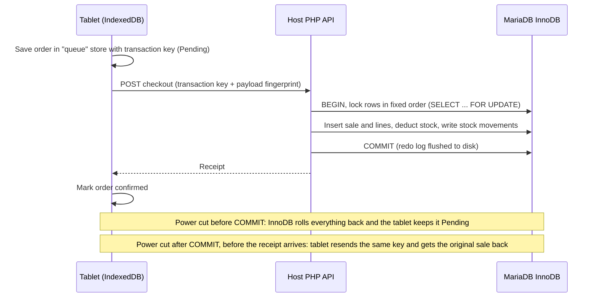

# Stage 4 — backup, restore and management operations

Run this application from `rebuild/`, using the same `config/local.php` as checkout. These procedures apply to the full rebuild only. They do not import an old phase database.

## Routine backup

1. Sign in as Owner/Admin. Open **Management → Backup & restore**.
2. Enter the current owner password and a separate backup passphrase (12–128 bytes). Download the `.vvbackup` file and verify the browser completed the download.
3. Keep a copy away from the host laptop; keep the passphrase separately. The application cannot recover a forgotten backup passphrase.
4. Back up the source/version and private `config/local.php` separately. Never commit configuration, downloaded backups or recovery codes to Git. Use a disposable installation to rehearse a restore before relying on a backup.

The file contains encrypted accounts/password hashes, catalogue, recipes, batches/containers, stock movements, sales and stored VAT, audit history, permanent checkout outcomes, recovery hashes and stock-operation replay records. It does **not** include application files, database configuration, browser drafts/queues, active sessions, rate-limit buckets or runtime restore metadata. Current owner credentials are preserved during in-app restore; staff credentials are restored from the file.

Encryption: AES-256-GCM with a random 16-byte salt, 12-byte IV and 16-byte authentication tag; PBKDF2-HMAC-SHA256 with 210,000 iterations derives the key. A wrong passphrase or altered ciphertext fails authentication. A successful download does not itself prove that the chosen file/passphrase can later be restored: rehearse on an isolated copy.

## In-app restore

1. Stop sales and stock edits on every device. Reconcile any cash already collected. Download a fresh backup of the **current** database before proceeding. Leave device browser storage intact.
2. Choose a Stage 4 `.vvbackup` file. Enter its passphrase and your current owner password. Click **Preview restore**.
3. Review the backup timestamp and current/replacement row counts. Preview checks format, schema, columns, scalar values, dates, owner identity, primary/foreign-key relationships, stock movement/batch/container/ingredient totals and stored sale/VAT totals without replacing data.
4. Type `RESTORE`, then select **Replace records and sign out**. Any application record change since preview—including new sales, login/logout audit events and edits—invalidates the preview. Review again in that case.
5. A successful restore signs everyone out. Sign in with the **current owner password**. The current owner recovery code still works. Baristas use the passwords stored in the backup; reset them through Account security if needed.
6. Check Reports and Audit history, then physically reconcile stock and cash. Review every device's pending orders and deliveries before reopening the register.

Restore requires the same single active owner ID and username as the current database. It replaces the declared business tables with prepared inserts, in foreign-key dependency order. It uses one InnoDB transaction under the same application lock as checkout. No `TRUNCATE`, schema changes, arbitrary uploaded SQL, or disabling of foreign keys occurs. Database constraints, coercion checks and stock/VAT invariants are rechecked before commit. Failure rolls back records, sessions and restore metadata together. MySQL may leave gaps in auto-increment IDs after rollback; those are not missing sales.

The restored audit history is the history contained in the backup, followed by a new `BACKUP_RESTORED` event. Later audit entries from the replaced database remain available only in the pre-restore backup. Keep both backups if that history is needed.

### Interrupted confirmation and older device requests

- Do not assume a timeout means failure. If the server committed but its response was lost, your session will have been revoked. Sign in again and check the `BACKUP_RESTORED` audit entry and actual records before attempting another restore.
- Restore rotates the host's restore epoch. Checkout, receiving and stock-operation requests retain the epoch captured when prepared. Requests from an earlier epoch return `RESTORE_REVIEW` without changing stock. Legacy requests lacking an epoch are accepted only before the host's first restore; afterward they also require review.
- Existing nonempty drafts keep their original epoch. Empty drafts can start afresh with the current epoch. Confirmed device history may describe a sale absent from an older restored backup: a device receipt alone is not evidence that a sale is present in the restored database.
- For each affected order, compare its items, cash, transaction key and timing with restored sales and physical stock. The owner decides whether to re-enter a missing sale or simply acknowledge an existing one. Never blindly resubmit or clear browser storage. Marking review complete only records a local acknowledgement; it does not insert a sale or adjust stock.
- The database backup does not save device-local orders. Keep devices and browser profiles available during recovery. A new host address uses different browser storage and needs deliberate operator reconciliation.

## Size limits and host configuration

The in-app format permits up to **8 MiB of plaintext JSON**, 100,000 rows per table and 250,000 rows overall. The encrypted file is larger because of Base64; the browser accepts up to 12 MiB and restore API requests up to 16 MiB. Ordinary API requests retain the 8 KiB limit. Reports allow at most 367 inclusive days and CSV exports at most 50,000 lines; choose smaller periods when needed.

Configure the PHP/Apache host to allow a 16 MiB JSON request (`post_max_size=16M` or larger), sufficient memory (256 MiB recommended), and enough execution time for the database size (for example `max_execution_time=180`). Restart Apache after changing `php.ini`. The UI waits up to 180 seconds for backup/restore. Runtime database permissions need SELECT/INSERT/UPDATE/DELETE on the rebuild tables; migrations separately need table-creation privileges. Keep all application tables InnoDB. Test the largest expected backup on the actual host; this stage's automated tests use smaller fixtures.

## Administrator fallback for larger databases

An authorized host administrator can use the installed MySQL/MariaDB dump tool or database administration interface. Keep the app stopped. Export the **rebuild database**, including all Stage 4 tables, into an access-controlled location outside the web root. With the installed dump tool, use `--single-transaction`, `--no-tablespaces`, the actual database name and a password prompt (`-p` without the password); never put passwords in a command or source file. Raw SQL exports are not encrypted by the in-app mechanism: protect them with your host's encrypted storage.

Restore a raw SQL dump into an **isolated replacement database first**, using the same compatible schema and database engine. Preserve the current database and configuration. Check the restored owner credentials and configure a test copy to use that database. Raw database restore can bring back older owner passwords and recovery hashes; it does not have the in-app owner-credential preservation behavior.

Before reconnecting devices, with the web server still stopped, run from `rebuild/`:

```bat
C:\xampp\php\php.exe tools\preflight.php
C:\xampp\php\php.exe tools\finalize-host-restore.php
C:\xampp\php\php.exe tools\recovery-code.php
```

The finalization tool requires the restored owner's current credentials, checks stock/VAT totals, revokes restored sessions, rotates the runtime epoch, and writes `HOST_RESTORE_FINALIZED`. It does not perform the database import. Keep the newly rotated owner recovery code offline. Rehearse checkout and reports on the replacement before switching the live configuration. Keep the old database untouched until the owner accepts the recovered state. Reconcile devices, stock and cash as described above.

## Other Stage 4 management workflows

- **Catalogue/ingredients:** create, edit and deactivate records. Delete only unused records; linked sale/stock history is protected. Used variants retain stored sale labels/prices/VAT even when the current catalogue changes.
- **Stock operations:** record waste or set an absolute counted quantity for a selected container. Reason, actor and timestamp are mandatory/server-recorded. The expected prior quantity prevents a stale form overwriting a concurrent sale. A positive correction cannot exceed the original received quantity or make expired/quarantined stock sellable. New stock belongs in a new delivery. Count corrections do not reset opening times or use-by dates.
- **Batch corrections:** change supplier, lot reference, expiration or quarantine status with a reason. This writes a zero-quantity `ADJUSTMENT` movement and before/after audit detail. Expiry corrections must reflect the actual delivery label; they do not reset an opened container's use-by.
- **Staff:** owner reauthentication creates or edits Barista accounts, including activation/deactivation. Saving an existing staff account revokes its sessions. No third role or owner promotion is exposed. Password resets remain in Account security.
- **Reports:** daily summaries (Z-reading) and period totals sum stored `gross`, `net` and `vat`; they do not recalculate history from current menu prices. VAT remittance is the recorded VAT total for the selected period under the agreed no-exemption/no-discount scope. The summary does not perform a fiscal register close. Receipt formatting alone does not constitute tax-system certification.
- **CSV:** every sale line has gross/net/VAT and the file ends with a totals row. Formula-leading staff/product text is escaped for spreadsheet use. Downloaded CSVs contain business records; handle them accordingly.

Stage 5 includes Nearby Café branding and handover guides. Actual Windows/XAMPP deployment and physical-device/client acceptance remain to be recorded in `ACCEPTANCE.md`. The backup format and recovery rules remain unchanged.

## After a power cut

InnoDB protects itself. Every confirmed sale is written to the database's redo log at COMMIT (`innodb_flush_log_at_trx_commit=1`). The next database start replays committed work and rolls back anything unfinished. There is nothing to "repair" by hand, and hand-made repairs are the main way data actually gets lost.

**Owner steps**

1. Restore power. Start the host laptop and double-click **Nearby Café**. Wait for **Ready**. The database recovers itself during this start, which can take a little longer than usual.
2. Ask baristas **not** to take new orders yet. Tablets keep their Pending orders safely; do not re-enter them.
3. In the `rebuild` folder, double-click **CHECK-DATABASE-AFTER-OUTAGE.bat**. It is read-only: it shows recent database recovery messages, runs `CHECK TABLE` on every application table, and checks the stock, batch, container, movement, VAT and checkout-outcome rules from one consistent snapshot.
4. **HEALTHY** → on each tablet open the register and use **Retry pending orders** (or wait for automatic retry). An order the server already committed returns its original receipt; it is not charged or deducted twice. Then reopen.
5. **ATTENTION**, or the database will not start → stop. Take a photo of the window and contact the developer. Keep tablets and their browser data untouched.

**Never do these, even if a website or forum recommends them**

| Action | Why it is dangerous |
|---|---|
| Delete `ib_logfile0`, `ib_logfile1` or `ibdata1` | These hold the redo log and system data. Deleting them discards committed sales and can make every table unreadable. |
| `REPAIR TABLE` / "Repair" buttons | Not supported for InnoDB. It does nothing useful and gives false confidence. |
| Setting `innodb_force_recovery` on the live database | It is an emergency export mode. Values of 4 and above can permanently damage data files. The integrity check refuses to report HEALTHY while it is set. |
| Re-running `tools/install.php`, setup SQL or the XAMPP "reset" | Replaces or conflicts with shop data. |
| Clearing tablet browser data | Deletes Pending orders that may not be on the server. |

The previous `PREPARE-OWNER-RECOVERY.bat` is unrelated: it prepares the Owner's **password** recovery code and is unchanged.

### Developer escalation: the database will not start

1. Keep the web service stopped. With `mysqld` stopped, copy the **whole** data directory (`DataDirectory` in `config/launcher.local.json`, normally `C:\xampp\mysql\data`) to external storage. Work only from this point forward; the copy is your evidence.
2. Read the end of `mysql_error.log` in that directory. Disk-full, permission and port errors are fixed at their cause; they are not corruption.
3. For genuine InnoDB corruption, prefer restoring the latest verified `.vvbackup` (in-app restore above) or the administrator dump procedure above.
4. Only if no usable backup exists: add `innodb_force_recovery=1` under `[mysqld]` in `my.ini`, start the database, and export with `mysqldump --single-transaction --no-tablespaces -p <database>` (password prompt). Stop the database and **remove the setting**. Raise the value one step at a time only if export fails, up to 3. Values 4 and above can permanently damage data files, so use them only against a copy of the data directory.
5. Import the dump into an **isolated replacement database**, then run `tools\preflight.php`, `tools\finalize-host-restore.php` and `tools\integrity-check.php` before switching `config/local.php`. Reconcile devices, stock and cash as described in the restore sections.

## QA chaos-test protocol (InnoDB atomicity and offline queue)

Owner: QA & Testing Specialist. Run tests 1–4 on a **rehearsal installation**, or on the shop host only with the Owner's consent, after a fresh verified `.vvbackup` and outside opening hours. Use a test product whose recipe and current stock you have written down.

### How the two durability layers fit together



Either way, the effect is **exactly one** sale and **one** set of stock deductions per order. The tablet layer prevents loss; the transaction key prevents duplication; InnoDB prevents partial writes.

### Test 0 — automated hard kill on a disposable database (about 20 s)

From `rebuild` in PowerShell (it creates its own data directory on test port 3307, refuses port 3306, and deletes everything afterwards):

```powershell
powershell.exe -NoProfile -ExecutionPolicy Bypass -File .\tests\chaos-hard-kill.ps1
```

It opens a transaction with an uncommitted INSERT and UPDATE, force-kills `mysqld`, restarts it, and checks for crash recovery in the log, zero partial writes, an intact committed row, and a HEALTHY integrity check. A negative control proves the checker detects a broken stock invariant. Expected ending: `ALL CHAOS CHECKS PASSED`. Verified on MariaDB 10.4.32 (XAMPP) on 27 October 2026, with log lines `Starting crash recovery from checkpoint`, `Rolled back recovered transaction` and `Rollback of non-prepared transactions completed`. This test uses a raw SQL transaction; tests 1–4 exercise the real checkout path.

### Test 1 — hard power-off during checkout (repeat 5 times)

1. Run `CHECK-DATABASE-AFTER-OUTAGE.bat` and record the `INFO sales=… gross=…` line and the test ingredient's stock.
2. On tablet A, add the test product and tap the button that completes the cash sale.
3. Within about one second, cut host power. **Laptop:** the battery keeps it running if you only pull the charger, so hold the power button for about 10 seconds. **Desktop:** pull the plug.
4. Tablet A must show the order under **Pending orders**, never as a lost order. Do not re-enter it.
5. Power on, start Nearby Café, run `CHECK-DATABASE-AFTER-OUTAGE.bat` → **HEALTHY**.
6. On tablet A tap **Retry pending orders**. Record the outcome: **A** = the sale had committed (original receipt returned), **B** = it had not (committed now).
7. Pass criteria for every run, whether A or B: sales count is exactly +1; the test ingredient decreased by exactly recipe quantity × items; the SQL checks below show no duplicates and no sale without deductions.

### Test 2 — response lost on the network

On tablet A, complete a sale and switch the tablet's Wi-Fi off immediately. The server probably commits, but the tablet never hears back and keeps it Pending. Switch Wi-Fi on and retry. Pass: the original receipt is shown, and the sales count increased by one only.

### Test 3 — offline queue across host downtime

1. With the app already open on tablets, click **Stop Nearby Café** on the host.
2. Take three orders on the tablets. They stay Pending. Close and reopen the tab (not a new browser profile) to show they persist on the device.
3. Start Nearby Café. Pass: all three commit once, with sales count +3.

The tablet must have loaded the app from the host before the outage. A page opened for the first time while the host is off cannot load; that is expected.

### Test 4 — three devices compete for the last stock

Set the test ingredient so exactly one drink can be made. On three tablets, complete the same sale at the same moment. Pass: exactly one succeeds; the others are rejected for insufficient stock; stock reaches 0, never negative; rejected sales have no stock movements.

### SQL evidence (read-only)

Open the MariaDB client on the host. Use the database name and user from `config/local.php`. `-p` prompts for the password; never type it into the command.

```bat
"C:\xampp\mysql\bin\mysql.exe" --user=root -p --host=127.0.0.1 venuevue_rebuild
```

```sql
SET SESSION TRANSACTION READ ONLY;
-- Latest sales: VAT reconciles to the centavo, and each sale has its stock deductions
SELECT s.id, s.transaction_key, s.sale_at, s.total_gross, s.total_net, s.total_vat,
       s.total_gross = s.total_net + s.total_vat AS vat_ok,
       (SELECT COUNT(*) FROM stock_movements m WHERE m.sale_id = s.id AND m.type = 'SALE') AS deductions
FROM sales s ORDER BY s.id DESC LIMIT 5;
-- Must return no rows: a transaction key is never committed twice
SELECT transaction_key, COUNT(*) FROM sales GROUP BY transaction_key HAVING COUNT(*) > 1;
-- Must return 0: no committed sale is missing its stock deductions (no partial writes)
SELECT COUNT(*) FROM sales s
WHERE NOT EXISTS (SELECT 1 FROM stock_movements m WHERE m.sale_id = s.id AND m.type = 'SALE');
-- Batches and containers each sale drew from (FEFO / opened-container order)
SELECT m.sale_id, i.name, m.batch_id, m.container_id, m.quantity_delta
FROM stock_movements m JOIN ingredients i ON i.id = m.ingredient_id
WHERE m.sale_id = (SELECT MAX(id) FROM sales) ORDER BY m.id;
-- Durable rejection outcomes (for example, test 4's insufficient-stock attempts)
SELECT transaction_key, error_code, created_at FROM checkout_rejections ORDER BY created_at DESC LIMIT 5;
```

**Device side:** on a laptop or desktop browser client, press F12 → **Application** → **IndexedDB** → `venuevue-rebuild-checkout` → **queue**. Each order is stored under its transaction key before it is sent, so you can match it with `sales.transaction_key`. Look only; never delete entries. Android tablets can be inspected from a laptop through `chrome://inspect` over USB.

### Academic defense run sheet (about 10 minutes)

1. **Durability settings:** run `CHECK-DATABASE-AFTER-OUTAGE.bat`. Point to `PASS durability`, `PASS CHECK TABLE` and `PASS … invariants`.
2. **Crash recovery, live:** run Test 0 on the projector. Point to `Rolled back recovered transaction` and `uncommitted INSERT is absent`.
3. **Real checkout power cut:** perform Test 1 once. Show the Pending order on the tablet, the HEALTHY check, the retry, and the single receipt.
4. **Proof in data:** run the SQL above. Duplicate query empty, missing-deductions count 0, `vat_ok = 1`, and deductions listed per container.
5. **Device queue:** show the IndexedDB `queue` entry with the same transaction key as the committed sale.

Record dates, device names, outcomes (A/B) and screenshots in `ACCEPTANCE.md`. Do not show passwords, recovery codes or private configuration on screen.
